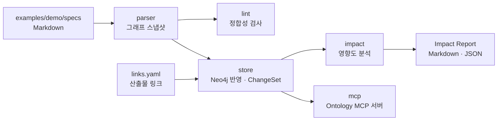

# 최소 구현 계획 (MVP 1단계)

| 항목 | 내용 |
|---|---|
| 기준 문서 | [PRD_ai-native-pipeline.md](PRD_ai-native-pipeline.md) v0.5 |
| 작성일 | 2026-10-16 |
| 상태 | Draft |

---

## 1. 목표

기획서(PRD → FDD → IA)를 쓰면 **온톨로지에 연결되고, 기획이 바뀌었을 때 영향받는 산출물이 근거와 함께 나온다**는 핵심 흐름을 처음부터 끝까지 동작하게 만든다.

**완료 기준**: 기획서 8.4의 "비밀번호 정책 변경" 시나리오를 실제로 재현한다.
- 예제 기획서에서 `RULE-PW-001`의 최소 길이를 8자에서 10자로 바꾼다.
- 린트가 하위 단계 미검토 항목을 잡아낸다.
- 수정을 반영한 뒤 영향도 분석을 돌리면 기획서 8.4 ③ 표와 같은 결과가 나온다. 기존 산출물 8건과 신규 작업 1건이 나오고, 등급과 근거 경로도 같아야 한다.
  - LLM 제외 제안은 이번 범위가 아니다. 그래서 LLM이 제외를 제안하던 3건도 결과에 그대로 남는다.

## 2. 범위

로드맵의 Phase 1(MVP)을 세 단계로 나누고, 이 계획은 **1a**만 다룬다.

| 단계 | 내용 | 이 계획 |
|---|---|---|
| **1a. 기획 엔진** | 작성 규약, 파서, 린트, 온톨로지 반영, 변경 감지, 영향도 분석, Ontology MCP 서버(읽기 도구) | **포함** |
| 1b. GitHub 연동 | PR마다 린트 실행, Impact Report 미리보기 코멘트 | 다음 계획 |
| 1c. 전파 | Dispatcher, Slack 승인 카드, ClickUp 태스크 발행, 완료 회신 | 다음 계획 |
| 2 이후 | LLM 보정, 관계 추론, 충돌 체크리스트, 도메인 에이전트 자동 착수 | 다음 계획 |

1a는 외부 서비스(GitHub API, Slack, ClickUp, LLM API) 없이 **로컬에서만** 돈다. 그래서 API 토큰이나 서버 호스팅 없이 시작할 수 있다.

**1a에서 제외하는 것**
- LLM이 필요한 기능: 변경 의미 요약, 영향 보정, 관계 추론, 충돌 체크리스트(L15)
- 하위 도메인 산출물의 실제 등록. 대신 예제 링크 파일로 대신한다 (M1).
- 사용자 접근 제어. MCP 서버의 프로젝트 범위 강제는 구현한다.

## 3. 확정한 결정 사항

| 항목 | 결정 | 이유 |
|---|---|---|
| 첫 구현 범위 | 1a 기획 엔진 | 외부 의존 없이 핵심 가치(정합성 검사, 영향 분석)를 먼저 검증 |
| 언어 | TypeScript (Node.js 24) | Neo4j 공식 드라이버, MCP 공식 SDK, Markdown 파서 생태계가 모두 갖춰져 있음. 이 Mac에 Node 24가 설치되어 있음 |
| 코드 위치 | 이 저장소(ProductDesign)에 함께 둠 | 초기에는 기획서와 코드를 같이 고치는 일이 많음. 커지면 분리 |
| 패키지 관리 | npm workspaces | 이미 설치되어 있고 추가 도구가 필요 없음 |
| 저장소 | Neo4j 5 (로컬) | 기획서 O1 결정 |
| 파일럿 데이터 | 예제 프로젝트 `DEMO` (기획서의 회원가입·로그인·계정 관리 예시) | 시나리오를 그대로 재현해 결과를 기획서와 비교할 수 있음 |
| 테스트 | Vitest. 그래프 로직은 메모리 그래프로 단위 테스트, Neo4j는 통합 테스트 | DB 없이도 대부분 검증 가능 |

## 4. 구조

```text
ProductDesign/
├── PRD_ai-native-pipeline.md
├── IMPLEMENTATION_PLAN.md
├── schema/
│   └── schema.yaml            # 온톨로지 스키마 (기획서 부록 A)
├── examples/demo/             # 파일럿 프로젝트 DEMO
│   ├── specs/                 # prd/, fdd/, ia/, glossary.md
│   └── links.yaml             # 산출물 링크 예제 (Figma·코드·TC 대역)
└── packages/
    ├── core/                  # 스키마 로더, 그래프 모델(노드·엣지 타입), 메모리 그래프
    ├── parser/                # Markdown → 그래프 스냅샷
    ├── lint/                  # 린트 규칙 L01~L18 (L15 제외)
    ├── store/                 # Neo4j 반영 (upsert, 버전, SpecVersion, ChangeSet)
    ├── impact/                # 영향도 분석 (전파 규칙, 등급, 근거 경로)
    ├── mcp/                   # Ontology MCP 서버 (읽기 도구)
    └── cli/                   # specflow 명령: lint, ingest, diff, impact
```

흐름:



## 5. 작업 단계

각 단계는 끝날 때 검증 방법이 있고, 앞 단계 결과 위에 쌓인다. M1~M3은 Neo4j 없이 진행할 수 있다.

### M0. 프로젝트 골격
- npm workspaces, TypeScript, Vitest, ESLint 설정
- `schema/schema.yaml` 작성 (기획서 부록 A를 실제 파일로)
- **검증**: `npm test`가 빈 테스트로 통과

### M1. 파일럿 기획서와 산출물 링크
- `examples/demo/specs/`에 기획서 6.2의 예시를 실제 파일로 작성
  - PRD: `prd.md`(FEAT-SIGNUP, FEAT-LOGIN, FEAT-ACCOUNT), `policies/password.md`(RULE-PW-001)
  - FDD: `signup.md`, `login.md`, `account.md`
  - IA: `sitemap.md`, `screens/*.md`
- `links.yaml`: 기획서 8.4의 산출물 8건(DSN 3, CODE 2, TC 3)과 기획 요소의 연결, `synced_version`
- **검증**: 사람이 읽었을 때 기획서 예시와 같은 내용

### M2. 파서
- front matter, `### {ID} {제목}` 헤딩, 필드 라벨, `[[ID]]` 참조, 정책 값 목록("- 항목: 값"), 괄호 출처 `(RULE-ID 항목)`를 읽는다
- 결과는 그래프 스냅샷(JSON): 노드(`uid`, `project`, `type`, `doc_level`, 내용 해시, 속성)와 엣지
- 필드 라벨→관계 매핑은 `schema.yaml`에서 읽는다 (코드에 하드코딩하지 않음)
- **검증**: DEMO 기획서 파싱 결과의 스냅샷 테스트. 노드·관계 개수와 주요 관계를 단언

### M3. 린트
- 스냅샷만으로 판단하는 규칙: L01~L08, L10~L14, L16~L18
- L09(하위 단계 미검토)는 이전 버전과 `synced_version`이 필요하므로 M4 이후에 붙인다
- 출력: 규칙 코드, 수준, 파일·줄 위치, 메시지. 사람이 읽는 형식과 JSON 두 가지
- **검증**: 규칙마다 일부러 틀리게 만든 예제로 잡히는지 테스트. DEMO 원본은 Error 0건

### M4. Neo4j 반영과 변경 감지
- 사전 준비: 로컬 Neo4j (아래 6장)
- `uid` 고유 제약, `project`·`type`·`status` 인덱스 생성
- upsert: 내용 해시가 바뀌면 `version` +1, 사라진 ID는 반영 거부(L05)
- 두 Git 커밋의 스냅샷을 비교해 ChangeSet 생성: 추가·수정·폐기, 변경 유형 분류는 **규칙 기반만**(정책 값 변경 → Rule 등). 규칙으로 정할 수 없으면 `Unclassified`로 두고 사람이 정한다
- `links.yaml`을 읽어 산출물 노드와 추적 링크 등록
- L09 구현: 상위 요소 버전 > 하위 링크 `synced_version`이면 Error. "변경 없음" 확인은 1a에서는 CLI 명령으로 처리
- **검증**: Neo4j 통합 테스트. 같은 입력을 두 번 반영해도 결과가 같음(멱등)

### M5. 영향도 분석
- 기획서 5.3 전파 규칙과 `max_depth`에 따른 탐색, 부록 B 등급 규칙, 근거 경로, 신규 작업 도출(F4 도메인 포함 기준)
- 탐색 로직은 메모리 그래프와 Neo4j 양쪽에서 같은 결과를 내도록 `core`의 인터페이스 위에 구현
- 출력: Impact Report (Markdown 표 + JSON)
- **검증 (완료 기준)**: 비밀번호 시나리오 E2E 테스트. 결과가 기획서 8.4 ③ 표와 일치

### M6. Ontology MCP 서버 (읽기)
- 도구: `get_element`, `search_elements`(1a는 키워드 검색만), `get_trace`, `get_schema`, `analyze_impact`, `get_sync_status`, `query_graph`(읽기 전용)
- 세션 시작 시 프로젝트 키를 받고, 모든 질의에 프로젝트와 `shared` 범위를 강제
- `query_graph`: 쓰기 구문 거부, 프로젝트 조건 강제, 결과 건수·시간 제한
- **검증**: Claude Code에 MCP 서버를 연결해 "RULE-PW-001을 바꾸면 어디가 영향받아?"에 근거 경로와 함께 답하는지 확인. 다른 프로젝트 데이터가 보이지 않는지 테스트

## 6. 시작 전에 준비할 것

| 항목 | 누가 | 필요 시점 | 내용 |
|---|---|---|---|
| 로컬 Neo4j | 사용자 | M4 | 이 Mac에는 Docker와 Java가 없다. 아래 중 하나를 설치해야 한다. **권장: Neo4j Desktop** (무료, 설치만 하면 로컬 DB 생성 가능). 대안: Docker Desktop(회사 규모에 따라 유료 라이선스 대상일 수 있음), Neo4j Aura Free(클라우드, 계정 필요, 일정 시간 미사용 시 일시 정지) |
| Neo4j 접속 정보 | 사용자 | M4 | 로컬 DB 비밀번호는 `.env`에 직접 넣는다. `.env`는 `.gitignore`에 추가한다 |

M0~M3은 준비 없이 바로 시작할 수 있다.

## 7. 구현하면서 정해야 할 기획서 빈틈

구현하면서 기획서에 반영할 항목이다. 정해지면 기획서를 함께 고친다.

| 항목 | 내용 | 1a의 임시 처리 |
|---|---|---|
| ID 동시 발급 | 두 PR이 동시에 같은 다음 번호(`REQ-SIGNUP-004`)를 받을 수 있다 | 린트 L04가 merge 전에 중복을 잡는다. 근본 해결(ID 예약)은 1b에서 |
| 변경 유형 자동 분류 | 규칙만으로 Behavioral·Copy·Editorial을 나누기 어렵다 | 규칙으로 정할 수 있는 것만 분류하고 나머지는 `Unclassified` |
| "변경 없음" 확인 방법 | 기획서는 PR 체크리스트로 정의했지만 1a에는 PR이 없다 | CLI 명령으로 대신한다 |
| 정책 값 비교 | "10자"와 "10 자", "열 자"를 같은 값으로 볼지 | 공백만 정규화하고 그대로 비교 |

## 8. 다음 계획 미리보기

- **1b GitHub 연동**: GitHub Actions에서 린트·영향 분석 실행, PR 코멘트, 브랜치 보호. GitHub 저장소 설정 권한이 필요하다.
- **1c 전파**: Slack 앱, ClickUp 토큰, Slack 버튼을 받을 서버 호스팅이 필요하다. 이 단계 전에 Slack 워크스페이스 관리자 승인과 ClickUp 구조(O5)를 정해야 한다.
