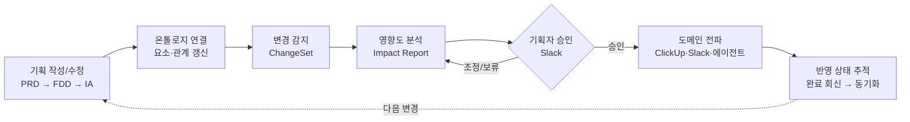
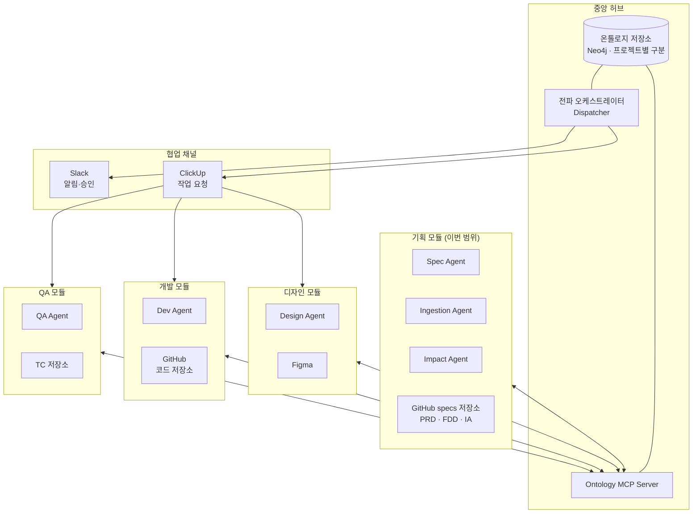
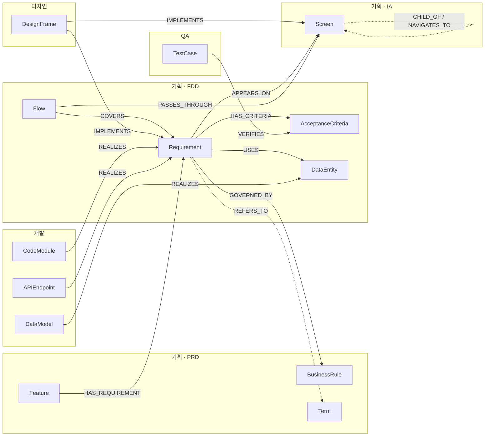
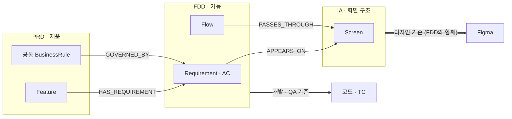
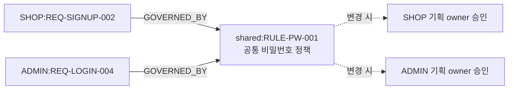
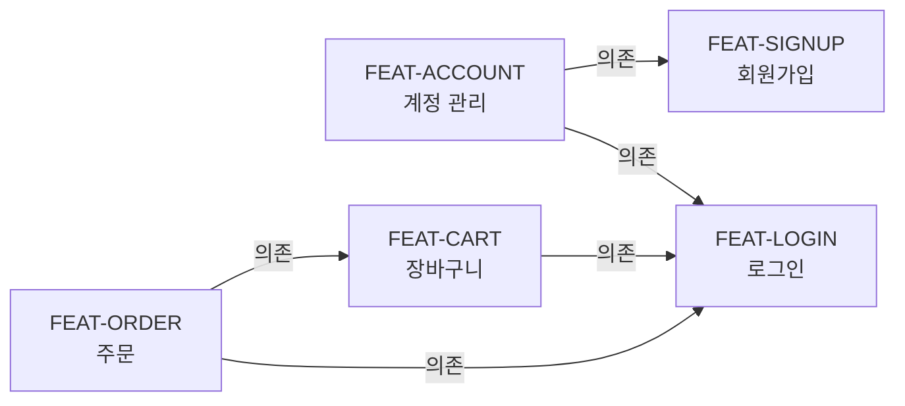
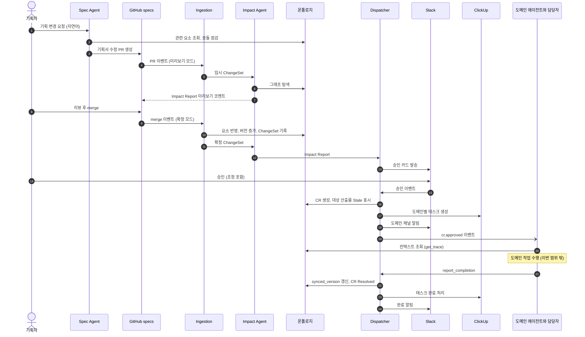
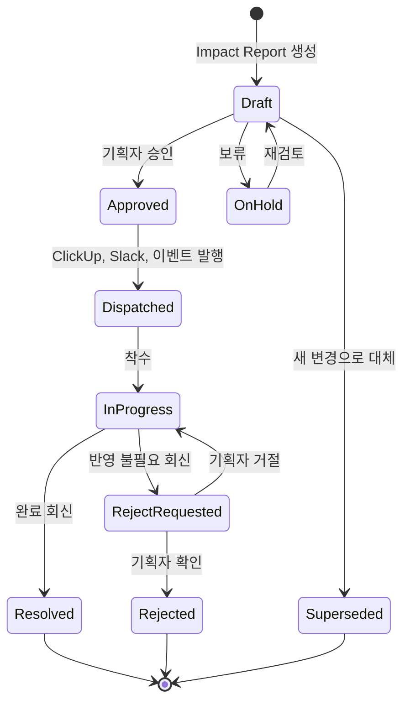
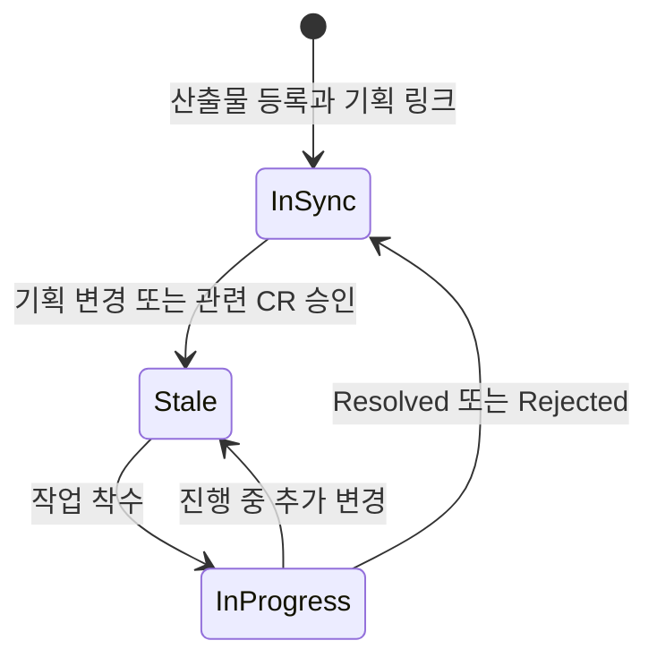
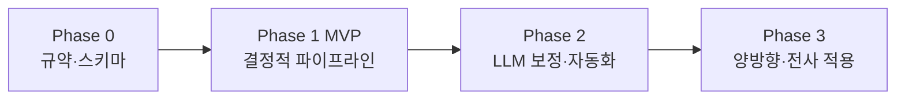

# AI-Native 개발 파이프라인 기획서

### 기획–온톨로지 연동 및 변경 전파 시스템

| 항목 | 내용 |
|---|---|
| 문서 ID | PRD-PIPELINE-001 |
| 버전 | v0.5 (초안) |
| 작성일 | 2026-10-16 |
| 작성자 | jisu.kim |
| 상태 | Draft |
| 연동 도구 | GitHub, Figma, ClickUp, Slack |

**변경 이력**

| 버전 | 날짜 | 내용 |
|---|---|---|
| v0.5 | 2026-10-16 | 기능 간 의존(5.10): PRD의 기능 의존과 FDD의 요구사항 의존으로 나눠 적고 린트(L16~L18)로 맞춤. 같은 단계의 옆 기능까지 연쇄 수정, 요구사항 의존 가중치를 medium으로, CR 안 항목 순서와 CR 간 선후 관계에 기능 의존 반영 |
| v0.4 | 2026-10-16 | 온톨로지를 "공통 스키마 + 저장소"로 정의하고 저장소를 기획 층과 링크·상태 층으로 나눔. 저장소를 Neo4j 단일 DB로 결정(O1). 멀티 프로젝트(5.9): 프로젝트 속성, 전역 ID, 공유 라이브러리, MCP 서버의 프로젝트 범위 강제. 읽기 전용 그래프 질의 도구 추가 |
| v0.3 | 2026-10-16 | 정책 값을 "- 항목: 값" 목록으로 쓰고, 다른 문서는 값과 괄호 출처로 인용(`CITES`). 정책 값 충돌을 린트(L07·L14)와 Spec Agent 충돌 체크리스트(L15)로 나눠 검사 |
| v0.2 | 2026-10-16 | 기획 산출물을 PRD → FDD → IA 3단계로 나눔. 단계별 기획 요소, 단계 간 연결(5.8), 기획 내부 연쇄 수정(F1), 저장소 구조와 작성 예시 갱신 |
| v0.1 | 2026-10-16 | 최초 작성 |

---

## 목차

0. [한눈에 보기](#0-한눈에-보기)
1. [개요](#1-개요)
2. [핵심 원칙](#2-핵심-원칙)
3. [용어 정의](#3-용어-정의)
4. [시스템 구조](#4-시스템-구조)
5. [온톨로지 모델](#5-온톨로지-모델)
6. [기획서 작성 규약 (Spec as Code)](#6-기획서-작성-규약-spec-as-code)
7. [기능 요구사항](#7-기능-요구사항)
8. [프로세스 플로우](#8-프로세스-플로우)
9. [에이전트 구성과 역할](#9-에이전트-구성과-역할)
10. [데이터 및 메시지 스키마](#10-데이터-및-메시지-스키마)
11. [인터페이스 접점 (UX)](#11-인터페이스-접점-ux)
12. [정책](#12-정책)
13. [성공 지표](#13-성공-지표)
14. [단계별 로드맵](#14-단계별-로드맵)
15. [리스크와 대응](#15-리스크와-대응)
16. [오픈 이슈](#16-오픈-이슈)
- [부록](#부록)

---

## 0. 한눈에 보기

> 기획서를 **코드처럼** 다룬다. 기획은 **PRD → FDD → IA** 세 단계 문서로 만들고, 모두 Git에서 버전 관리한다. 모든 기획 요소는 ID를 가진 노드로 **온톨로지(지식 그래프)** 에 연결된다. 상위 단계가 바뀌면 Spec Agent가 하위 단계의 수정 초안을 같은 PR에 넣어 기획 안의 정합성을 먼저 맞춘다. 기획이 바뀌면 그래프를 따라 영향받는 디자인·코드·TC를 찾아내고, **기획자가 승인하면** 도메인별 작업 요청이 ClickUp과 Slack으로 나간다. 각 산출물이 어느 기획 버전까지 반영됐는지는 온톨로지가 계속 추적한다.



**이 문서가 다루는 것**: 위 그림의 A~G 전체. 단, F 이후 디자인·개발·QA가 **실제로 작업하는 방법**은 각 도메인 기획에서 다루고, 이 문서는 도메인과 주고받는 **요청·회신 규약**까지만 정의한다.

---

## 1. 개요

### 1.1 배경

기획 → 디자인 → 개발 → QA로 이어지는 제품 개발 파이프라인을 AI 에이전트 중심으로 재구성한다. 각 도메인은 독립 모듈로 운영되고, 도메인마다 에이전트가 작업을 수행하거나 보조한다.

이 파이프라인의 모든 하위 작업은 **기획을 기반으로** 이루어진다. 그런데 기획서는 한 번 쓰고 끝나는 문서가 아니라 제품이 살아 있는 동안 계속 수정된다. 코드에서 함수 하나를 고치면 호출하는 곳을 함께 고쳐야 하듯, 기획 한 곳이 바뀌면 그 기획을 근거로 만든 디자인·코드·TC도 함께 바뀌어야 한다.

### 1.2 문제 정의

| # | 문제 | 현상 | 결과 |
|---|---|---|---|
| P1 | 변경이 전파되지 않음 | 기획이 바뀌어도 디자인·코드·TC는 이전 기획 기준으로 남음 | 산출물끼리 어긋나고, QA나 운영 단계에서 뒤늦게 발견됨 |
| P2 | 영향 범위를 사람이 추적함 | "이 정책을 바꾸면 어디를 고쳐야 하지?"를 기억과 검색에 의존 | 누락, 반복 확인에 드는 커뮤니케이션 비용 |
| P3 | 변경 요청이 비정형 | Slack 메시지나 구두로 전달 | 무엇을 요청했고 처리됐는지 추적 불가 |
| P4 | 에이전트 간 공통 컨텍스트 부재 | 도메인 에이전트가 기획서 원문을 각자 해석 | 에이전트마다 다른 결론, 근거 없는 추론 |

### 1.3 목표

| # | 목표 | 해결하는 문제 |
|---|---|---|
| G1 | 기획서를 ID를 가진 구조화된 요소로 나누고 온톨로지에 연결한다 | P4 |
| G2 | 기획이 바뀌면 영향받는 하위 산출물을 자동으로 찾는다 | P1, P2 |
| G3 | 기획자 승인 후 도메인별 작업 요청을 각 도메인의 작업 도구로 발행한다 | P3 |
| G4 | 각 산출물이 어느 기획 버전까지 반영했는지 추적한다 | P1 |

### 1.4 범위

| 구분 | 내용 |
|---|---|
| **포함** | 기획 산출물 3단계(PRD → FDD → IA)의 작성 규약(Spec as Code)과 작성 보조 에이전트 |
| | 기획 내부 연쇄 수정 (상위 단계 변경 시 하위 단계 수정 초안) |
| | 기획서 → 온톨로지 연결 (파싱, 관계 추출, 버전 관리) |
| | 하위 산출물 → 기획 역링크 규약 (디자인·코드·TC가 기획 ID를 참조하는 방식) |
| | 변경 감지, 영향도 분석 |
| | 변경 요청(CR) 생성, 기획자 승인, 도메인 전파 |
| | 산출물 동기화 상태 추적, 리마인드, 다이제스트 |
| | 도메인 에이전트 인터페이스 (요청 이벤트, 완료 회신 형식) |
| **제외** | 디자인·개발·QA 에이전트가 실제로 작업하는 로직 (도메인별 기획에서 정의) |
| | 기능별 출시 순서 같은 일정 관리 (ClickUp에서 관리) |
| | 도메인 → 기획 방향 피드백의 상세 설계 (Phase 3에서 별도 기획) |
| | 온톨로지 저장소(Neo4j) 인프라 운영 (배포, 백업, 모니터링) |

### 1.5 사용자

| 역할 | 하는 일 | 이 시스템에서 얻는 것 |
|---|---|---|
| 기획자 (PM/PO) | PRD·FDD·IA 작성·수정, 변경 승인 | 변경 영향을 자동으로 파악하고, 전파와 반영 여부를 한곳에서 확인 |
| 디자이너 | Figma 작업 | 어떤 프레임을 왜 고쳐야 하는지 근거가 붙은 요청 |
| 개발자 | 코드 구현 | 관련 요구사항·정책·코드 위치가 정리된 요청 |
| QA | TC 작성·실행 | 수정·신규·폐기할 TC 목록과 검증 시점 |
| 도메인 에이전트 | 도메인 작업 수행·보조 | 구조화된 입력과 온톨로지 컨텍스트 |

---

## 2. 핵심 원칙

| # | 원칙 | 설명 |
|---|---|---|
| 1 | **기획이 출발점이다** | 모든 하위 산출물은 하나 이상의 기획 요소에 연결되어야 한다. 연결되지 않은 산출물은 "근거 없는 산출물"로 리포트한다. |
| 2 | **원본은 역할을 나눠 둔다** | 기획 *내용*의 원본은 Git의 Markdown이다. 온톨로지 저장소는 두 층으로 나뉜다. **기획 층**은 Git에서 파생되며 언제든 다시 만들 수 있다. **링크·상태 층**(산출물 링크, CR 상태, 승인 이력)은 원본이 이곳뿐이라 이 층이 진짜 기록이다 (5.1). |
| 3 | **도메인끼리 직접 요청하지 않는다** | 모든 변경은 온톨로지에 기록되고 오케스트레이터가 이벤트로 전달한다. 도메인 모듈을 바꾸거나 추가해도 다른 도메인에 영향이 없다. |
| 4 | **규칙은 코드로, 판단은 LLM으로** | 파싱, 그래프 탐색, 티켓 발행처럼 규칙으로 처리되는 일은 코드가 한다. 변경 의미 요약, 영향 보정처럼 판단이 필요한 일은 LLM이 하되 결과에 반드시 근거(그래프 경로, diff 위치)를 붙인다. |
| 5 | **최초 기획도 변경이다** | 신규 기획은 "빈 상태에서 모든 요소가 추가된 변경"으로 처리한다. 신규와 수정이 같은 파이프라인을 타므로 예외 흐름이 생기지 않는다. |
| 6 | **발행은 사람이 승인한다** | 에이전트는 영향 분석과 요청 초안까지 만든다. 도메인에 실제로 발행하는 것은 기획자 승인 후다. |
| 7 | **에이전트는 같은 창구로 온톨로지에 접근한다** | 온톨로지를 MCP 서버로 노출해, 모든 에이전트가 같은 도구(조회, 영향 분석, 링크 등록, 완료 회신)를 쓴다. 에이전트는 DB에 직접 붙지 않는다. 쓰기는 목적별 도구로만 하고, MCP 서버가 모든 요청에 프로젝트 범위를 강제한다 (5.9). |

---

## 3. 용어 정의

| 용어 | 정의 |
|---|---|
| 기획서 (Spec) | Git 저장소에서 Markdown으로 관리하는 기획 문서. PRD, FDD, IA 세 단계로 나뉜다. |
| PRD (Product Requirement Document) | 제품 전체의 목표, 대상 사용자, 범위, 기능 목록, 공통 정책, 성공 지표를 정의하는 최상위 기획 문서 |
| FDD (Feature Design Document) | PRD의 기능 하나를 상세화한 문서. 요구사항, 인수 조건, 사용자 플로우, 예외 처리, 데이터를 정의한다. 기능마다 하나씩 쓴다. |
| IA (Information Architecture) | 화면 구조 문서. 메뉴 계층, 화면 간 이동, 화면마다 어떤 요구사항이 배치되는지를 정의한다. |
| 기획 단계 (doc_level) | 기획 요소가 정의된 문서 단계. `prd`, `fdd`, `ia` 중 하나 |
| 기획 요소 (Spec Element) | 기획서 안에서 ID를 가진 최소 단위. Feature, BusinessRule, Term(PRD), Requirement, AcceptanceCriteria, Flow, DataEntity(FDD), Screen(IA)이 있다. |
| 연쇄 수정 | 상위 단계 기획이 바뀌었을 때 하위 단계 기획을 맞춰 고치는 일. 같은 기획자가 같은 PR 안에서 처리한다. |
| 요구사항 (Requirement, REQ) | 시스템이 해야 하는 일 하나. 하위 산출물이 연결되는 기본 단위다. |
| 인수 조건 (AcceptanceCriteria, AC) | 요구사항이 충족됐는지 판단하는 검증 가능한 조건. TC의 근거가 된다. |
| 정책 (BusinessRule, RULE) | 여러 요구사항에 공통으로 적용되는 규칙. 예: 비밀번호 정책 |
| 산출물 (Artifact) | 하위 도메인이 만든 결과물. Figma 프레임, 코드 모듈, API, 데이터 모델, TC |
| 추적성 (Traceability) | 기획 요소와 산출물 사이의 연결 관계 |
| 온톨로지 (Ontology) | 두 가지를 함께 가리킨다. ① **공통 스키마**: 노드 타입, 관계 타입, 전파 규칙, 기획 단계 정의(`schema.yaml`). 모든 에이전트가 같은 말로 기획을 이해하게 하는 공통 어휘다. ② **저장소**: 이 스키마를 따르는 그래프 데이터. Neo4j 단일 DB에 저장한다. |
| 기획 층 / 링크·상태 층 | 온톨로지 저장소의 두 층. 기획 층은 Git의 기획서에서 파생되어 다시 만들 수 있다. 링크·상태 층은 산출물 링크, CR·동기화 상태, 승인 이력이며 원본이 저장소뿐이다. |
| 프로젝트 키 | 프로젝트를 구분하는 짧은 이름 (예: `SHOP`). 모든 노드의 `project` 속성과 전역 ID(`SHOP:REQ-SIGNUP-002`)에 쓴다. |
| 공유 라이브러리 | 여러 프로젝트가 함께 쓰는 기획 요소(회사 공통 정책 등)를 모아 둔 특수 프로젝트. 프로젝트 키는 `shared`다. |
| ChangeSet (CS) | 기획서 PR 하나에 담긴 기획 요소 변경의 묶음 |
| 영향도 분석 (Impact Analysis) | ChangeSet에서 출발해 영향받는 산출물을 찾는 과정 |
| Impact Report | 영향도 분석 결과. 도메인별 영향 목록, 등급, 근거 경로, LLM 제안을 담는다. |
| 변경 요청 (Change Request, CR) | 승인된 변경에 따라 한 도메인에 보내는 작업 요청. 1 ChangeSet → 도메인마다 CR 1개 |
| Domain Task | CR이 ClickUp에 생성된 실제 태스크 |
| 동기화 상태 (Sync Status) | 산출물이 최신 기획을 반영했는지 나타내는 상태 (In-Sync, Stale, In-Progress) |
| 요소 버전 (version) | 기획 요소의 내용이 의미 있게 바뀔 때마다 1씩 오르는 정수 |
| synced_version | 산출물이 마지막으로 반영한 기획 요소의 버전. 추적 링크마다 기록한다. |

---

## 4. 시스템 구조

### 4.1 전체 구성도

온톨로지를 가운데 둔 허브-스포크 구조다. 도메인 모듈은 서로 직접 연결되지 않고, 모두 온톨로지(MCP)와 오케스트레이터를 거친다.



### 4.2 구성 요소

| 구성 요소 | 역할 | 구현 방식 |
|---|---|---|
| 온톨로지 저장소 | 기획 요소, 산출물, 관계, 버전, 동기화 상태, CR을 저장하는 그래프. 기획 층과 링크·상태 층으로 나뉜다 | Neo4j 단일 DB. 프로젝트는 노드 속성으로 구분 (5.9) |
| Ontology MCP Server | 에이전트가 온톨로지를 읽고 쓰는 단일 창구. 프로젝트 범위를 강제하고, 도메인별 쓰기 권한을 제한한다. | MCP 서버 |
| 전파 오케스트레이터 (Dispatcher) | CR 생성·승인 처리·발행·상태 관리. 같은 입력이면 항상 같은 결과를 낸다. | 결정적 워크플로 (LLM 사용 안 함) |
| Spec Agent | 기획 작성 보조, 규약 변환, 충돌 탐지, PRD → FDD → IA 연쇄 수정 초안 | LLM 에이전트 (대화형) |
| Ingestion Agent | 기획서 파싱, 온톨로지 반영, ChangeSet 생성 | 코드 + LLM 보조 |
| Impact Agent | 그래프 탐색으로 영향 분석, LLM으로 보정 | 코드 + LLM 보정 |
| 도메인 에이전트 | 디자인·개발·QA 작업 수행 | 이번 범위 밖. 인터페이스만 정의 |

### 4.3 도구별 역할

| 도구 | 역할 | 이 시스템에서 다루는 것 |
|---|---|---|
| **GitHub** | 기획서 원본 저장소, 코드 저장소 | 기획 PR이 변경 단위가 된다. PR 코멘트로 Impact Report 미리보기를 단다. 코드 PR 본문의 `Implements:` 태그로 역링크를 건다. |
| **Figma** | 디자인 산출물 | 프레임에 기획 ID를 태깅하고, 프레임 링크를 산출물 노드로 등록한다. |
| **ClickUp** | 도메인 작업 요청의 단일 창구 | CR마다 도메인 List에 태스크를 만들고, 태스크 상태를 CR 상태와 동기화한다. |
| **Slack** | 알림과 승인 | 기획자 승인 카드, 도메인 채널 알림, 기한 리마인드, 주간 다이제스트를 보낸다. |

---

## 5. 온톨로지 모델

이 시스템의 핵심이다. 기획 요소와 산출물을 어떤 노드로 표현하고, 어떤 관계로 잇고, 변경이 어느 방향으로 퍼지는지를 정의한다.

### 5.1 설계 방향

- **속성 그래프**로 표현하고 **Neo4j**에 저장한다. 노드와 엣지 모두 속성을 가진다. 노드 라벨은 타입(`:Requirement`, `:DesignFrame` 등)에만 쓴다.
- 노드는 도메인별 타입을 가진다. 엣지는 방향과 타입을 가진다.
- 모든 노드의 공통 속성: `uid`(프로젝트 키를 붙인 전역 ID), `project`, `id`, `type`, `domain`, `title`, `version`, `status`, `source`(원본 위치 URL), `updated_at`. `uid`에 고유 제약을 건다.
- 스키마(타입과 관계 정의)는 `specs/_ontology/schema.yaml`에 두고 Git으로 관리한다. (부록 A)
- 형식 추론(OWL 등)은 쓰지 않는다. 이 시스템에 필요한 것은 정해진 깊이의 그래프 탐색과 상태 관리다.

**저장소의 두 층**

| 층 | 담는 것 | 누가 쓰나 | 원본 | 잃어버리면 |
|---|---|---|---|---|
| 기획 층 | 기획 요소(PRD·FDD·IA), 기획 요소 간 관계, 정책 값, 요소 버전 | Ingestion Agent | Git의 기획서 | Git에서 다시 만들 수 있음 |
| 링크·상태 층 | 산출물 노드와 추적 링크(`synced_version`), ChangeSet, CR과 상태, 승인·반려·LLM 제안 처리 이력 | 도메인 에이전트, Dispatcher | 이 저장소 | 복구 불가. 백업 대상 |

영향도 분석은 "정책 → 요구사항 → 그 요구사항을 반영한 Figma·코드·TC"처럼 두 층을 한 번에 따라간다. 두 층을 한 저장소에 두는 이유다.

### 5.2 노드 타입

**기획 도메인** — Git의 기획서에서 생성된다. 모든 기획 요소는 자신이 정의된 문서 단계를 `doc_level` 속성(`prd`, `fdd`, `ia`)으로 가진다.

| 단계 | 타입 | ID 접두사 | 설명 | 예시 |
|---|---|---|---|---|
| PRD | Feature | `FEAT` | 사용자 관점의 기능 묶음. FDD 하나와 짝을 이룬다 | `FEAT-SIGNUP` 회원가입 |
| PRD | BusinessRule | `RULE` | 여러 기능에 걸친 공통 정책. 항목별 정책 값(`values`)을 속성으로 가진다 | `RULE-PW-001` 비밀번호 정책 (최소 길이: 10자, …) |
| PRD | Term | `TERM` | 용어 | `TERM-MEMBER` 회원 |
| FDD | Requirement | `REQ` | 요구사항 | `REQ-SIGNUP-002` 비밀번호 설정 |
| FDD | AcceptanceCriteria | `AC` | 인수 조건 | `AC-SIGNUP-002-01` |
| FDD | Flow | `FLOW` | 사용자 플로우 (요구사항들을 거치는 순서) | `FLOW-SIGNUP-01` 이메일 가입 |
| FDD | DataEntity | `DATA` | 데이터 항목 | `DATA-USER` 사용자 |
| FDD | BusinessRule | `RULE` | 한 기능에만 적용되는 정책 | `RULE-SIGNUP-001` 가입 연령 제한 |
| IA | Screen | `SCR` | 화면. 메뉴 계층과 화면 간 이동을 가진다 | `SCR-SIGNUP` 회원가입 화면 |

**하위 도메인** — 각 도메인이 산출물을 등록할 때 생성된다.

| 도메인 | 타입 | ID 접두사 | 원본 | 예시 |
|---|---|---|---|---|
| 디자인 | DesignFrame | `DSN` | Figma 프레임 | `DSN-SIGNUP-PW` |
| 디자인 | DesignComponent | `DSC` | Figma 컴포넌트 | `DSC-PW-INPUT` |
| 개발 | CodeModule | `CODE` | 코드 경로 | `CODE-auth/password-validator` |
| 개발 | APIEndpoint | `API` | API 명세 | `API-POST-/auth/signup` |
| 개발 | DataModel | `MDL` | DB 스키마 | `MDL-users` |
| QA | TestCase | `TC` | TC 저장소 | `TC-SIGNUP-007` |

**메타** — 파이프라인이 생성한다.

| 타입 | ID 접두사 | 설명 |
|---|---|---|
| SpecVersion | (commit SHA) | 기획 저장소의 특정 시점 스냅샷 |
| ChangeSet | `CS` | 기획 PR 하나의 변경 묶음 |
| ChangeRequest | `CR` | 도메인별 작업 요청 |
| DomainTask | (ClickUp ID) | ClickUp 태스크 참조 |

### 5.3 관계 타입과 전파 규칙

`전파` 열은 변경이 어느 방향으로 퍼지는지를 뜻한다.
- **정방향**: 출발 노드가 바뀌면 도착 노드가 영향받는다.
- **역방향**: 도착 노드가 바뀌면 출발 노드가 영향받는다.
- **양방향**: 어느 쪽이 바뀌어도 반대쪽이 영향받는다.

**기획 요소 간 관계** — 영향 범위를 넓히는 데 쓴다.

| 관계 | 출발 → 도착 | 의미 | 전파 | 가중치 |
|---|---|---|---|---|
| `HAS_REQUIREMENT` | Feature → Requirement | 기능이 요구사항을 포함 (PRD → FDD) | 정방향 | low |
| `HAS_CRITERIA` | Requirement → AC | 요구사항의 인수 조건 | 양방향 | high |
| `GOVERNED_BY` | Requirement → BusinessRule | 요구사항이 정책을 따름 | 역방향 | high |
| `APPEARS_ON` | Requirement → Screen | 요구사항이 화면에 나타남 (FDD → IA) | 양방향 | medium |
| `USES` | Requirement → DataEntity | 요구사항이 데이터를 사용 | 역방향 | medium |
| `FEATURE_DEPENDS_ON` | Feature → Feature | 기능 간 의존 (PRD). 정합성 검사와 의존 지도에 쓴다 (5.10) | — (전파는 요구사항 의존으로) | — |
| `DEPENDS_ON` | Requirement → Requirement | 요구사항 간 의존 (FDD). 다른 기능의 요구사항도 가리킬 수 있다 | 역방향 | medium |
| `REFERS_TO` | (모든 기획 요소) → Term | 용어 참조 | 역방향 | low |
| `CITES` | (모든 기획 요소) → BusinessRule | 정책 값 인용. 어느 항목을 어떤 값으로 인용했는지(`item`, `value`)를 속성으로 가진다 | 역방향 | high |
| `COVERS` | Flow → Requirement | 플로우가 거치는 요구사항 | 양방향 | medium |
| `PASSES_THROUGH` | Flow → Screen | 플로우가 지나가는 화면 (FDD → IA) | 양방향 | medium |
| `CHILD_OF` | Screen → Screen | 메뉴 계층의 상위 화면 | 역방향 | low |
| `NAVIGATES_TO` | Screen → Screen | 화면 간 이동 | 역방향 | low |

**추적 관계** — 산출물을 기획에 연결한다. 모두 `synced_version` 속성을 가진다.

| 관계 | 출발 → 도착 | 의미 | 전파 |
|---|---|---|---|
| `IMPLEMENTS` | DesignFrame → Screen, Requirement, Flow | 디자인이 화면·요구사항·플로우(프로토타입)를 구현 | 역방향 |
| `REALIZES` | CodeModule, APIEndpoint → Requirement / DataModel → DataEntity | 코드가 요구사항·데이터를 구현 | 역방향 |
| `VERIFIES` | TestCase → AC, Requirement, Flow | TC가 인수 조건·요구사항·플로우(E2E)를 검증 | 역방향 |

**메타 관계**

| 관계 | 출발 → 도착 | 의미 |
|---|---|---|
| `MODIFIES` | ChangeSet → 기획 요소 | 이 변경이 수정한 요소 |
| `PRODUCES` | ChangeSet → ChangeRequest | 변경에서 나온 작업 요청 |
| `TARGETS` | ChangeRequest → 산출물 | 작업 요청의 대상 |
| `TRACKED_BY` | ChangeRequest → DomainTask | ClickUp 태스크 연결 |
| `SUPERSEDES` | ChangeRequest → ChangeRequest | 이전 요청을 대체 |
| `SPLIT_INTO` / `MERGED_INTO` | 기획 요소 → 기획 요소 | 요소의 분리·병합 이력 |

> 도메인 내부 관계(예: DesignFrame → DesignComponent, CodeModule → APIEndpoint 호출)는 각 도메인이 관리한다. 이번 범위의 영향 분석은 기획 요소에서 산출물까지만 탐색한다.

### 5.4 온톨로지 구조도



### 5.5 동기화 판정: `synced_version`

"코드처럼 한 곳이 바뀌면 여파가 퍼진다"를 구현하는 장치다.

1. 기획 요소는 내용이 의미 있게 바뀔 때마다 `version`이 1 오른다. (표현만 다듬은 Editorial 변경은 올리지 않는다.)
2. 산출물을 기획 요소에 연결하는 추적 링크(`IMPLEMENTS`, `REALIZES`, `VERIFIES`)는 **연결 당시 또는 마지막 반영 당시의 요소 버전**을 `synced_version`으로 기록한다.
3. 산출물은 아래 둘 중 하나에 해당하면 **Stale**이다.
   - **직접 변경**: 링크의 `synced_version` < 연결된 요소의 `version`
   - **간접 변경**: 승인된 미완료 CR이 이 산출물을 대상으로 하고 있음 (예: 정책이 바뀌어 요구사항 자체는 그대로지만 영향을 받는 경우)
4. CR이 완료(Resolved)되거나 반영 불필요로 확정(Rejected)되면 해당 링크의 `synced_version`을 현재 요소 버전으로 올리고 산출물은 **In-Sync**로 돌아온다.

```text
REQ-SIGNUP-002 (version 4)
  ├─ IMPLEMENTS ← DSN-SIGNUP-PW                  synced_version 4  → In-Sync
  └─ REALIZES   ← CODE-auth/password-validator   synced_version 4  → In-Sync
AC-SIGNUP-002-01 (version 2)
  └─ VERIFIES   ← TC-SIGNUP-007                  synced_version 1  → Stale (직접 변경)
```

직접 변경 판정은 언제든 버전 비교로 다시 계산할 수 있다. 간접 변경은 CR이 기록하므로, 온톨로지만 보면 "지금 어떤 산출물이 왜 최신이 아닌지"를 항상 설명할 수 있다.

### 5.6 ID 정책

| 항목 | 규칙 |
|---|---|
| 형식 | `{접두사}-{범위}-{일련번호}`. 예: `REQ-SIGNUP-002`, AC는 상위 REQ 번호를 이어 `AC-SIGNUP-002-01` |
| 전역 ID | 저장소에서는 프로젝트 키를 붙인 `uid`로 구분한다. 예: `SHOP:REQ-SIGNUP-002`. 기획서 안에서는 같은 프로젝트 요소를 프로젝트 키 없이 쓰고, 다른 프로젝트나 공유 라이브러리 요소만 키를 붙인다 (예: `[[shared:RULE-PW-001]]`) |
| 발급 | Spec Agent가 온톨로지에서 다음 번호를 받아 부여한다 (`next_id`). 사람이 직접 써도 린트가 중복을 검사한다. |
| 불변 | 한 번 부여한 ID는 바꾸거나 재사용하지 않는다. 파일을 옮기거나 제목을 바꿔도 ID는 유지된다. |
| 삭제 | 삭제하지 않고 `status: deprecated`로 표시한다. 연결된 산출물에는 폐기 작업 요청이 나간다. |
| 분리·병합 | 요구사항 하나를 둘로 나누면 원래 ID는 deprecated, 새 ID와 `SPLIT_INTO`로 잇는다. 병합은 `MERGED_INTO`. 기존 산출물 링크는 새 ID로 옮길지 도메인에 확인 요청한다. |

### 5.7 Ontology MCP 도구

모든 에이전트는 아래 도구로만 온톨로지에 접근한다. 도구는 두 종류다.
- **목적별 도구**: 정해진 일을 하는 도구. 쓰기는 이 도구로만 한다.
- **읽기 전용 그래프 질의 도구**(`query_graph`): 목적별 도구로 답할 수 없는 질문을 위한 탐색용 도구. 에이전트가 Cypher를 직접 쓴다.

모든 도구 호출에는 MCP 서버가 세션의 프로젝트 범위를 자동으로 적용한다 (5.9).

| 도구 | 설명 | 주 사용자 | 권한 |
|---|---|---|---|
| `get_element(id)` | 기획 요소의 내용, 버전, 관계 조회 | 전체 | 읽기 |
| `search_elements(query, type)` | 키워드·의미 검색 (Neo4j 벡터 인덱스) | Spec Agent, 도메인 에이전트 | 읽기 |
| `get_trace(id, depth)` | 요소의 상하위 연결 그래프 조회 | 전체 | 읽기 |
| `next_id(type, scope)` | 다음 ID 발급 | Spec Agent | 읽기 |
| `analyze_impact(changeset_id)` | 영향도 분석 실행 | Impact Agent | 읽기 |
| `upsert_spec_elements(snapshot)` | 기획 요소·관계 반영 | Ingestion Agent | 기획 노드 쓰기 |
| `link_artifact(artifact, element_id, relation)` | 산출물 등록과 기획 링크 생성 | 도메인 에이전트 | 자기 도메인 쓰기 |
| `report_completion(cr_id, result)` | CR 완료·반영 불필요 회신 | 도메인 에이전트, 담당자 | 자기 도메인 CR |
| `get_sync_status(scope)` | 동기화 현황 조회 | 기획자, Dispatcher | 읽기 |
| `get_schema()` | 노드·관계 타입과 전파 규칙 조회. 처음 붙는 에이전트가 구조를 파악할 때 쓴다 | 전체 | 읽기 |
| `query_graph(cypher)` | 읽기 전용 Cypher 질의. MCP 서버가 쓰기 구문이 없는지 검사하고, 프로젝트 조건을 강제로 붙이고, 결과 건수와 실행 시간을 제한한다 | 전체 | 읽기 |

### 5.8 기획 단계(PRD · FDD · IA) 간 연결

기획 도메인 안에도 상위에서 하위로 내려가는 흐름이 있다. 하위 단계 문서는 상위 단계 요소를 참조하고, 상위 단계 문서는 하위 단계를 참조하지 않는다.



> 그림의 화살표는 "상위가 하위의 근거가 된다"는 흐름을 나타낸다. 온톨로지에 저장되는 관계의 방향은 5.3 표를 따른다 (예: `GOVERNED_BY`는 Requirement → BusinessRule).

**단계별로 정하는 것**

| 단계 | 단위 | 정하는 것 | 참조하는 상위 요소 |
|---|---|---|---|
| PRD | 제품(또는 제품 영역) 하나 | 목표, 대상 사용자, 범위, 기능 목록(Feature), 공통 정책, 성공 지표 | — |
| FDD | 기능(Feature) 하나 | 요구사항, 인수 조건, 사용자 플로우, 예외 처리, 데이터, 기능 전용 정책 | Feature, 공통 정책, 용어 |
| IA | 제품 하나 (사이트맵 + 화면별 파일) | 메뉴 계층, 화면 간 이동, 화면마다 배치할 요구사항 | 요구사항, 플로우 |

**하위 도메인이 기준으로 삼는 단계**

| 도메인 | 주 기준 | 함께 보는 것 |
|---|---|---|
| 디자인 | IA (화면 구조, 이동) | FDD (요구사항, 플로우, 노출 문구) |
| 개발 | FDD (요구사항, 정책, 데이터) | IA (라우팅, 화면 간 이동) |
| QA | FDD (인수 조건, 플로우) | IA (E2E 경로) |

**기획 단계 간 동기화**

- 단계를 넘는 관계(`HAS_REQUIREMENT`, `GOVERNED_BY`, `APPEARS_ON`, `PASSES_THROUGH`)도 추적 관계처럼 `synced_version`을 가진다. 예를 들어 IA의 화면이 FDD 요구사항을 참조할 때, 그 요구사항의 어느 버전을 보고 배치했는지 기록한다.
- 상위 단계 요소가 바뀌면 이 링크로 하위 단계 요소가 Stale이 된다. 하위 단계 기획자에게 따로 변경 요청(CR)을 보내지 않는다. PRD·FDD·IA를 같은 기획자가 쓰므로, Spec Agent가 **같은 PR 안에** 하위 단계 수정 초안을 넣고 기획자가 검토한다 (F1).
- 기획자가 하위 요소를 수정하거나 "변경 없음"으로 확인하면 `synced_version`이 올라간다. 하위 단계에 Stale이 남은 PR은 merge할 수 없다 (린트 L09). 그래서 디자인·개발·QA로 전파가 시작되는 시점에는 PRD·FDD·IA가 항상 서로 맞는 상태다.

### 5.9 멀티 프로젝트

기획이 필요한 프로젝트가 늘어나도 온톨로지 저장소는 **Neo4j DB 하나**로 운영한다. 프로젝트는 DB를 나누지 않고 노드 속성으로 구분한다.

**구분 방식**

| 항목 | 규칙 |
|---|---|
| 프로젝트 속성 | 모든 노드와 엣지에 `project` 속성(프로젝트 키)을 넣는다. 프로젝트를 노드 라벨로 만들지 않는다. 프로젝트마다 라벨이 늘어나면 스키마가 복잡해진다. |
| 전역 ID | `uid` = `{프로젝트 키}:{ID}`. `uid`에 고유 제약을 건다. 프로젝트마다 `REQ-SIGNUP-002`가 있어도 충돌하지 않는다. |
| 프로젝트 등록 | 프로젝트마다 `Project` 노드(키, 이름, 기획 저장소 위치, 기획 owner)를 둔다. |
| 인덱스 | 자주 쓰는 조회 조건(`project`, `type`, `status`)에 인덱스를 건다. |

**프로젝트 범위 강제**

Neo4j 무료판(Community)에는 사용자별 접근 제어가 없다. 쿼리에 프로젝트 조건이 빠지면 다른 프로젝트 데이터가 보인다. 그래서 접근을 막는 책임을 **Ontology MCP 서버 한 곳**에 둔다.
- 에이전트와 사람 모두 DB에 직접 접근하지 않는다. 온톨로지는 MCP 서버로만 읽고 쓴다.
- MCP 세션은 시작할 때 프로젝트 키를 받는다. 서버는 그 세션의 모든 조회·쓰기에 프로젝트 조건을 자동으로 붙인다.
- `query_graph`로 들어온 Cypher도 서버가 프로젝트 조건을 강제로 붙인 뒤 실행한다.
- 세션이 볼 수 있는 범위는 자기 프로젝트와 공유 라이브러리(`shared`)뿐이다. 공유 라이브러리는 읽기만 할 수 있다.

**공유 라이브러리**

여러 프로젝트가 함께 쓰는 기획 요소(회사 공통 비밀번호 정책, 공통 용어 등)는 공유 라이브러리 프로젝트(`shared`)에 둔다.
- 각 프로젝트의 기획서는 `[[shared:RULE-PW-001]]`처럼 프로젝트 키를 붙여 참조한다.
- 공유 요소가 바뀌면 영향도 분석이 프로젝트를 넘어 퍼진다. 그 요소를 참조하는 모든 프로젝트에 각각 ChangeSet과 승인 요청이 생기고, 각 프로젝트의 기획 owner가 따로 승인한다.
- 공유 라이브러리 수정 권한은 기획 리드에게만 있다.



**아직 정할 것** — 16장 O8, O9
- 기획 저장소를 프로젝트마다 따로 둘지, 하나의 저장소에 프로젝트 폴더로 나눌지
- 공유 요소 변경을 각 프로젝트가 거절할 수 있는지 (공유 정책을 따르지 않는 예외를 허용할지)

### 5.10 기능 간 의존

기능(Feature)끼리도 의존한다. 예를 들어 주문은 로그인과 장바구니를 전제로 한다. 의존은 두 단계에서 나눠 적는다.

| 단계 | 적는 것 | 관계 | 역할 |
|---|---|---|---|
| PRD | 기능이 **무엇에** 의존하는지 | `FEATURE_DEPENDS_ON` | 기획자가 전체 구조를 보는 지도. 정합성 검사의 기준 |
| FDD | 요구사항 단위로 **정확히 어디에** 의존하는지 | `DEPENDS_ON` | 변경이 실제로 퍼지는 경로 |

- 데이터 공유(`USES`), 화면 경유(`PASSES_THROUGH`), 정책 공유(`GOVERNED_BY`)로 생기는 의존은 이미 관계로 잡혀 있어 따로 적지 않는다.
- 두 단계가 서로 맞는지는 린트가 검사한다 (L16~L18).
  - FDD에서 다른 기능의 요구사항에 의존하면 PRD에도 그 기능 의존이 있어야 한다.
  - PRD에만 있고 FDD에 근거가 없는 의존은 아직 상세화되지 않았다는 경고다.
- 기능 의존 지도는 PRD에서 자동으로 만들어 기획 PR 코멘트에 붙인다 (F1). 변경된 기능과 그 기능에 의존하는 기능을 강조한다.



> 화살표는 "의존하는 기능 → 의존받는 기능" 방향이다. 로그인이 바뀌면 화살표를 거꾸로 따라 계정 관리, 장바구니, 주문이 검토 대상이 된다.

**범위 밖**: "로그인을 먼저 출시해야 주문을 출시할 수 있다" 같은 일정상 순서는 기능 의존과 다른 정보다. ClickUp의 프로젝트 일정에서 관리한다.

---

## 6. 기획서 작성 규약 (Spec as Code)

기획서가 기계가 읽을 수 있는 형식이어야 온톨로지에 정확히 연결된다. 다만 기획자가 이 형식을 직접 외울 필요는 없다. Spec Agent가 자연어 초안을 규약 형식으로 바꿔준다 (F1).

### 6.1 저장소 구조

문서 단계마다 폴더를 나눈다. 상위 단계에서 하위 단계 순서로 작성한다.

```text
specs/
├── _ontology/
│   └── schema.yaml           # 노드·관계 타입 정의 (부록 A)
├── glossary.md               # 용어 (TERM)
├── prd/                      # 1단계 PRD
│   ├── prd.md                # 목표, 사용자, 범위, 기능 목록(FEAT), 성공 지표
│   └── policies/             # 공통 정책 (RULE)
│       └── password.md
├── fdd/                      # 2단계 FDD — 기능(FEAT)마다 하나
│   ├── signup.md             # REQ, AC, FLOW, DATA, 기능 전용 RULE
│   ├── login.md
│   └── account.md
└── ia/                       # 3단계 IA
    ├── sitemap.md            # 메뉴 계층과 화면 목록
    └── screens/              # 화면별 정의 (SCR)
        ├── signup.md
        └── account.md
```

### 6.2 문서 형식

- 파일 맨 위에 YAML front matter를 둔다. 공통 필드는 `id`, `doc`(`prd`·`fdd`·`ia`), `title`, `owner`, `status`, `version`이다. FDD는 어느 기능을 상세화하는지 `feature`를 추가로 적는다.
- 기획 요소는 `### {ID} {제목}` 헤딩으로 시작한다.
- 다른 요소는 `[[ID]]`로 참조한다. 파서는 요소 타입과 필드 라벨을 보고 관계 타입을 정한다.
- 하위 단계 문서만 상위 단계 요소를 참조한다. 그래서 요구사항과 화면의 연결(`APPEARS_ON`)은 FDD가 아니라 IA에 적는다. FDD를 쓰는 시점에는 아직 화면이 정해지지 않았기 때문이다.
- **정책 값은 "- 항목: 값" 목록으로 쓴다.** 정책(RULE) 헤딩 아래의 각 줄이 정책 값 하나가 된다. 표나 코드 블록이 아니라 일반 글머리 목록이라 누구나 그대로 읽을 수 있다. 기계는 "정책 ID + 항목 이름"(예: `RULE-PW-001`의 `최소 길이`)으로 값을 식별한다.
- **다른 문서에서 정책 값을 쓸 때는 값을 그대로 쓰고 출처를 괄호로 단다.** 예: `10자 미만이면 … 표시한다. (RULE-PW-001 최소 길이)`. 읽는 사람은 값을 바로 보고, 기계는 이 값이 어느 정책 항목인지 안다 (`CITES` 관계). 출처 달기는 Spec Agent가 초안을 만들 때 대신 붙여 준다.

| 문서 | 요소 | 필드 라벨 | 관계 |
|---|---|---|---|
| PRD·FDD | BusinessRule | `- 항목: 값` (그 밖의 라벨) | 정책 값. `설명:`만 예외로 본문 설명 |
| FDD | (모든 요소의 본문) | `(RULE-ID 항목)` 괄호 출처 | `CITES` (정책 값 인용) |
| FDD | (front matter) | `feature:` | `HAS_REQUIREMENT` (문서 안의 모든 요구사항에 적용) |
| FDD | Requirement | `정책:` | `GOVERNED_BY` |
| FDD | Requirement | `데이터:` | `USES` |
| PRD | Feature | `의존:` | `FEATURE_DEPENDS_ON` |
| FDD | Requirement | `의존:` | `DEPENDS_ON` (다른 기능의 요구사항도 가능) |
| FDD | Requirement | `인수 조건:` | `HAS_CRITERIA` (하위 항목이 AC 노드가 됨) |
| FDD | Requirement | `노출: 없음` | 관계 없음. 화면이 필요 없는 요구사항 표시 (린트 L11 제외) |
| FDD | Flow | `단계:` | `COVERS` (순서 있음) |
| IA | Screen | `상위:` | `CHILD_OF` |
| IA | Screen | `이동:` | `NAVIGATES_TO` |
| IA | Screen | `요구사항:` | `APPEARS_ON` (Requirement → Screen으로 저장) |
| IA | Screen | `플로우:` | `PASSES_THROUGH` (Flow → Screen으로 저장) |

**① PRD 작성 예시** — `specs/prd/prd.md`, `specs/prd/policies/password.md`

````markdown
---
id: PRD-MAIN
doc: prd
title: 회원 서비스 PRD
owner: jisu.kim
status: approved
version: 1.3.0
---

## 목표
- 가입 완료율을 높이고, 계정 보안 사고를 줄인다.

## 기능 목록

### FEAT-SIGNUP 회원가입
- 설명: 신규 사용자가 이메일로 계정을 만든다.
- 정책: [[RULE-PW-001]]

### FEAT-LOGIN 로그인
- 설명: 회원이 이메일과 비밀번호로 로그인한다.
- 정책: [[RULE-PW-001]]

### FEAT-ACCOUNT 계정 관리
- 설명: 회원이 비밀번호와 프로필을 관리한다.
- 정책: [[RULE-PW-001]]
- 의존: [[FEAT-LOGIN]] (로그인한 회원만 접근), [[FEAT-SIGNUP]]
````

````markdown
---
id: PRD-POLICY-PW
doc: prd
title: 비밀번호 정책
owner: jisu.kim
status: approved
version: 1.2.0
---

### RULE-PW-001 비밀번호 정책
- 최소 길이: 8자
- 필수 문자: 영문, 숫자 각 1개 이상
- 적용 대상: 모든 회원
- 설명: 가입과 비밀번호 변경 시 검증한다.
````

**② FDD 작성 예시** — `specs/fdd/signup.md`

````markdown
---
id: FDD-SIGNUP
doc: fdd
feature: FEAT-SIGNUP
title: 회원가입 FDD
owner: jisu.kim
status: approved          # draft | review | approved | deprecated
version: 1.4.0
---

## 요구사항

### REQ-SIGNUP-001 이메일 입력
- 설명: 사용자는 이메일을 입력하고 중복 여부를 확인한다.
- 데이터: [[DATA-USER]]
- 인수 조건:
  - AC-SIGNUP-001-01: 이미 가입된 이메일이면 "이미 사용 중인 이메일입니다"를 표시한다.

### REQ-SIGNUP-002 비밀번호 설정
- 설명: 사용자는 정책에 맞는 비밀번호를 설정한다.
- 정책: [[RULE-PW-001]]
- 의존: [[REQ-SIGNUP-001]]
- 인수 조건:
  - AC-SIGNUP-002-01: 8자 미만이면 "8자 이상 입력해주세요"를 표시한다. (RULE-PW-001 최소 길이)
  - AC-SIGNUP-002-02: 비밀번호 확인 값이 다르면 가입 버튼을 비활성화한다.
  - AC-SIGNUP-002-03: 영문과 숫자가 모두 포함되지 않으면 안내 문구를 표시한다.

## 플로우

### FLOW-SIGNUP-01 이메일 가입
- 단계: [[REQ-SIGNUP-001]] → [[REQ-SIGNUP-002]]
- 예외: 이메일 중복 시 로그인 화면으로 안내
````

**③ IA 작성 예시** — `specs/ia/sitemap.md`, `specs/ia/screens/signup.md`

````markdown
---
id: IA-SITEMAP
doc: ia
title: 사이트맵
owner: jisu.kim
status: approved
version: 1.1.0
---

- 홈 [[SCR-HOME]]
  - 회원가입 [[SCR-SIGNUP]]
    - 가입 완료 [[SCR-SIGNUP-DONE]]
  - 내 계정 [[SCR-ACCOUNT]]
    - 비밀번호 변경 [[SCR-ACCOUNT-PW]]
````

````markdown
---
id: IA-SCR-SIGNUP
doc: ia
title: 회원가입 화면
owner: jisu.kim
status: approved
version: 1.1.0
---

### SCR-SIGNUP 회원가입
- 상위: [[SCR-HOME]]
- 요구사항: [[REQ-SIGNUP-001]], [[REQ-SIGNUP-002]]
- 플로우: [[FLOW-SIGNUP-01]]
- 이동: [[SCR-SIGNUP-DONE]] (가입 완료 시), [[SCR-LOGIN]] (이메일 중복 시)
- 구성: 이메일 입력, 비밀번호 입력, 비밀번호 확인, 가입 버튼
````

> 사이트맵의 들여쓰기 목록은 화면 정의 파일의 `상위:` 필드와 같은 정보다. 파서는 둘이 다르면 린트 에러로 알린다.

### 6.3 린트 규칙

기획 PR마다 자동으로 검사한다. Error가 있으면 merge할 수 없다.

정합성 검사는 두 층으로 나뉜다. 규칙으로 판단할 수 있는 불일치(L01~L14)는 린트가 직접 잡는다. 판단이 필요한 불일치(출처 없이 쓴 정책 값, 문장끼리의 의미 충돌)는 Spec Agent가 찾아 체크리스트로 올리고 기획자가 결정한다. 린트는 그 체크리스트가 모두 처리됐는지만 본다(L15).

| 코드 | 규칙 | 수준 |
|---|---|---|
| L01 | front matter 필수 필드(`id`, `doc`, `title`, `owner`, `status`, `version`, FDD는 `feature`)가 있다 | Error |
| L02 | 모든 요구사항·인수 조건·정책·플로우·화면은 ID를 가진다 | Error |
| L03 | `[[ID]]`로 참조한 요소가 존재하고 deprecated가 아니다 | Error |
| L04 | ID가 중복되지 않고, deprecated ID를 재사용하지 않는다 | Error |
| L05 | 기존 ID가 사라지지 않았다 (삭제 대신 deprecated) | Error |
| L06 | 요구사항마다 인수 조건이 1개 이상 있다 | Error |
| L07 | 같은 정책 항목이 두 곳 이상에서 서로 다른 값으로 정의되지 않았다 (예: `RULE-PW-001`의 최소 길이가 두 문서에서 다름) | Error |
| L08 | 용어집에 없는 용어를 쓰지 않았다 | Warning |
| L09 | 상위 단계 변경으로 Stale이 된 하위 단계 요소가 남아 있지 않다 (수정했거나 "변경 없음"으로 확인함) | Error |
| L10 | 상위 단계 문서가 하위 단계 요소를 참조하지 않는다 (PRD → FDD·IA, FDD → IA 참조 금지) | Error |
| L11 | 요구사항이 IA의 화면 하나 이상에 배치되어 있다 (`노출: 없음` 제외) | Warning |
| L12 | PRD의 Feature마다 FDD가 하나씩 있다 | Warning |
| L13 | 사이트맵 계층과 화면 정의의 `상위:` 필드가 일치한다 | Error |
| L14 | 괄호 출처를 단 값이 정책 값과 일치한다 (예: `(RULE-PW-001 최소 길이)`를 달고 "8자"라고 썼는데 정책은 10자) | Error |
| L15 | Spec Agent가 올린 충돌 체크리스트(F1)에 처리하지 않은 항목이 없다 | Error |
| L16 | FDD의 요구사항이 다른 기능의 요구사항에 의존하면, PRD에도 그 기능 의존이 있다 | Error |
| L17 | PRD의 기능 의존마다 FDD에 근거가 되는 요구사항 의존이 하나 이상 있다 | Warning |
| L18 | 기능 의존이 순환하지 않는다 (A → B → A) | Warning |

### 6.4 변경 유형과 버전 정책

모든 변경은 아래 6가지 유형 중 하나로 분류된다. 유형에 따라 요소 버전 증가 여부, 문서 버전, 전파 대상이 정해진다.

| 변경 유형 | 예시 | 요소 version | 문서 버전 (SemVer) | 전파 |
|---|---|---|---|---|
| **Structural** (구조) | 화면·플로우·요구사항 추가·삭제·분리 | +1 | major | 예 |
| **Rule** (정책) | 비밀번호 최소 길이 8자 → 10자 | +1 | major | 예 |
| **Behavioral** (동작) | 실패 시 처리 방식 변경, AC 수정 | +1 | minor | 예 |
| **Data** (데이터) | 필드 추가, 형식 변경 | +1 | minor | 예 |
| **Copy** (노출 문구) | 사용자에게 보이는 안내·에러 문구 변경 | +1 | minor | 예 (주로 디자인·QA) |
| **Editorial** (표현 정리) | 오탈자, 문장 다듬기. 의미 변화 없음 | 유지 | patch | 아니오 |

- **문서 버전**은 front matter의 `version`(SemVer)이다. 한 PR에 여러 유형이 섞이면 가장 높은 수준을 따른다. Spec Agent가 분류 결과로 버전 증가를 제안한다.
- **요소 버전**은 온톨로지가 관리하는 정수이며, 동기화 판정(5.5)에 쓴다.
- Copy와 Editorial을 나눈 이유: 기획서 문장을 다듬는 것은 하위에 영향이 없지만, 화면에 노출되는 문구가 바뀌면 디자인과 TC를 고쳐야 한다.

---

## 7. 기능 요구사항

각 기능을 **트리거 / 입력 / 처리 / 출력 / 예외**로 정리한다.

### F1. 기획 작성 보조 (Spec Agent)

| 항목 | 내용 |
|---|---|
| 목적 | 기획자가 자연어로 쓰면 규약에 맞는 PRD·FDD·IA가 나오게 한다. 누락과 충돌을 작성 단계에서 잡고, 상위 단계가 바뀌면 하위 단계를 함께 맞춘다. |
| 트리거 | 기획자가 에이전트에게 요청 (대화형), 또는 기획 PR 생성·업데이트 |
| 입력 | 자연어 메모, 회의록, 기존 기획서 |
| 출력 | 기획서 PR (연쇄 수정 초안 포함), 점검 결과·연쇄 수정 체크리스트·기능 의존 지도 코멘트 |

**처리**
1. 자연어 초안을 6.2 형식으로 바꾸고 `next_id`로 ID를 부여한다. 내용에 맞는 단계(PRD·FDD·IA) 문서에 넣는다.
2. 누락을 점검한다.
   - 인수 조건이 없는 요구사항
   - 예외 케이스: 실패, 빈 값, 권한 없음, 네트워크 오류, 기존 데이터 처리
   - 본문에 언급됐지만 참조가 빠진 정책·데이터
   - FDD가 없는 Feature, IA에 배치되지 않은 요구사항
3. 온톨로지와 대조한다.
   - 비슷한 요구사항이 이미 있는지 (중복)
   - 용어집과 다른 표현을 쓰는지
   - 정책 값 충돌: 규칙으로 잡히는 것(L07 중복 정의, L14 출처를 단 값의 불일치)은 린트가 판단한다. Spec Agent는 그 밖의 경우를 찾는다.
     - 출처 없이 정책 값을 쓴 문장 (예: FDD 본문의 "최소 8자") → 정책 값과 같으면 출처 달기를, 다르면 수정을 제안한다.
     - 문장끼리 의미가 어긋나는 경우 (예: PRD "주문은 회원만 가능" ↔ FDD "비회원 주문 시 …")
   - 찾은 항목은 근거(어느 문서의 어느 문장끼리 부딪히는지)와 함께 PR의 **충돌 체크리스트**에 올린다. 기획자가 항목마다 "고침" 또는 "충돌 아님(사유)"으로 처리해야 merge할 수 있다 (L15). 찾는 것은 에이전트, 결정은 기획자다.
4. **연쇄 수정 초안 (PRD → FDD → IA)**: 상위 단계 요소가 바뀌면 단계 간 관계(5.8)를 따라 영향받는 하위 단계 요소를 찾는다.
   - 고쳐야 할 요소는 수정 초안을 만들어 **같은 PR**에 커밋한다. 예: PRD 정책의 최소 길이가 바뀌면 FDD 인수 조건의 "8자" 문구를 고친다. 그 정책 항목을 괄호 출처로 인용한 문장은 `CITES` 관계로 빠짐없이 찾는다.
   - 고칠 필요가 없어 보이는 요소는 사유와 함께 "변경 없음" 후보로 올린다.
   - PR 코멘트에 단계별 체크리스트를 단다. 기획자가 항목마다 초안을 수락·수정하거나 "변경 없음"을 체크하면 해당 링크의 `synced_version`이 올라간다.
   - 하위 단계 탐색은 PRD → FDD → IA 순서로 한 단계씩 내려간다. FDD 초안이 확정되어야 IA 초안을 만든다.
   - **같은 단계의 옆 기능도 본다.** 요구사항의 동작·정책·구조가 바뀌면(Editorial·Copy 제외), 그 요구사항에 `DEPENDS_ON`으로 의존하는 다른 기능의 요구사항도 체크리스트에 올린다. 예: `REQ-LOGIN-001`이 바뀌면 주문 FDD의 `REQ-ORDER-001`.
   - FDD에 다른 기능 의존을 새로 적었는데 PRD에 기능 의존이 없으면(L16), PRD에 의존을 추가하는 초안을 함께 만든다.
   - 기능 의존 지도(5.10)를 PR 코멘트에 붙인다.
5. 변경 유형을 분류하고 문서 버전 증가를 제안한다. 연쇄 수정으로 함께 바뀐 하위 문서의 버전도 제안한다.
6. 린트(6.3)를 실행한다. 체크리스트에 남은 항목이 있으면 L09로 merge가 막힌다.

**예외**
- 충돌을 발견하면 자동으로 고치지 않는다. 선택지를 제시하고 기획자가 고른다.
- 기획자가 규약 변환 결과나 연쇄 수정 초안을 고치면 그 수정을 우선한다.
- 하위 단계 문서를 먼저 고쳤는데 상위 단계와 맞지 않으면(예: FDD에서 PRD에 없는 정책 값을 씀) 상위 단계를 고칠지, 하위 단계를 되돌릴지 기획자에게 묻는다.

### F2. 온톨로지 연결 (Ingestion)

| 항목 | 내용 |
|---|---|
| 목적 | 기획서를 온톨로지의 노드·관계로 반영한다. 하위 산출물이 기획에 연결되는 규약을 정한다. |
| 트리거 | (a) 기획 PR 생성·업데이트: **미리보기 모드** — 임시 그래프에서만 계산하고 온톨로지에 반영하지 않음<br/>(b) main 브랜치 merge: **확정 모드** — 온톨로지에 반영 |
| 입력 | 기획서 Markdown, 이전 SpecVersion |
| 출력 | 갱신된 온톨로지, SpecVersion 노드, ChangeSet(F3로 전달) |

**처리**
1. **결정적 파싱**: front matter, ID 헤딩, 필드 라벨, `[[ID]]` 참조, 정책 값 목록, 괄호 출처를 노드·속성·엣지로 바꾼다. 요소마다 front matter의 `doc` 값을 `doc_level`로 기록하고, 단계를 넘는 관계에는 `synced_version`을 붙인다 (5.8).
2. **Upsert**: ID 기준으로 반영한다. 요소 내용이 바뀌었고 변경 유형이 Editorial이 아니면 `version`을 1 올린다.
3. **관계 추론 (LLM 보조)**: 본문에 명시되지 않은 관계 후보를 찾는다.
   - 예: 요구사항 설명에 "비밀번호"가 나오지만 `RULE-PW-001` 참조가 없음
   - 후보는 `status: proposed`, `confidence`와 함께 저장하고 PR 코멘트로 기획자에게 확인을 요청한다.
   - 기획자가 수락하면 **기획서에 참조를 추가하는 방식으로** 확정한다. 원본은 기획서이므로 온톨로지에만 있는 관계는 만들지 않는다.
4. SpecVersion 노드(commit SHA)를 만들고 변경 요소와 잇는다.

**하위 산출물 역링크 규약**

하위 도메인은 산출물을 만들 때 기획 ID를 태깅한다. 이 태그가 추적 링크의 근거다.

| 도메인 | 태깅 위치 | 형식 | 등록 방식 |
|---|---|---|---|
| 디자인 | Figma 프레임 설명 또는 플러그인 데이터 | `spec: REQ-SIGNUP-002, SCR-SIGNUP` | Design Agent가 `link_artifact` 호출. 보완책으로 주기 스캔 |
| 개발 | PR 본문, 코드 주석 | PR: `Implements: REQ-SIGNUP-002`<br/>코드: `// @spec REQ-SIGNUP-002` | GitHub webhook → `link_artifact` |
| QA | TC 메타데이터 | `verifies: AC-SIGNUP-002-01` | QA Agent가 `link_artifact` 호출 |

- 링크를 등록할 때 `synced_version`은 그 시점의 요소 버전으로 기록한다.
- 기획 ID가 없는 Figma 프레임, PR, TC는 **미연결 산출물**로 주간 다이제스트에 올린다.

**예외**
- 파싱 실패: merge 전 린트에서 막히므로 확정 모드에서는 발생하지 않아야 한다. 발생하면 반영을 중단하고 기획자와 운영 채널에 알린다.
- 참조한 산출물이 원본에서 삭제됨(Figma 프레임 삭제 등): 산출물 노드를 `missing`으로 표시하고 도메인에 확인을 요청한다.

### F3. 변경 감지

| 항목 | 내용 |
|---|---|
| 목적 | 기획 PR에서 무엇이 어떻게 바뀌었는지 요소 단위로 정리한다. |
| 트리거 | F2에서 이전 SpecVersion 대비 요소 변경이 발생 |
| 입력 | 이전·이후 기획 요소 스냅샷 |
| 출력 | ChangeSet (스키마 10.1) |

**처리**
1. 요소 단위로 비교한다: 추가, 수정, 폐기(deprecated), 이동, 분리·병합
2. 변경 유형(6.4)을 분류한다. 규칙을 먼저 적용하고(예: 정책 블록의 값 변경 → Rule), 규칙으로 정할 수 없으면 LLM이 분류한다.
3. LLM이 변경 의미를 한 줄로 요약한다. 예: "비밀번호 최소 길이 8자 → 10자, 특수문자 필수"
4. before/after 원문을 함께 저장한다.

**예외**
- Editorial만 있는 ChangeSet은 영향 분석을 건너뛰고 기록만 남긴다.
- 파일 이동이나 이름 변경은 ID가 같으면 변경으로 보지 않는다.

### F4. 영향도 분석

| 항목 | 내용 |
|---|---|
| 목적 | 변경 때문에 다시 봐야 하는 산출물을 도메인별로 찾고, 왜 영향받는지 근거를 붙인다. |
| 트리거 | ChangeSet 생성 (미리보기·확정 모두) |
| 입력 | ChangeSet, 온톨로지 |
| 출력 | Impact Report (도메인별 영향 목록, 등급, 근거 경로, LLM 제안) |

**처리**
1. **확장**: 변경된 요소에서 출발해, 기획 요소 간 관계를 전파 규칙(5.3)에 따라 따라가며 관련 요소를 모은다. 기본 최대 깊이는 3단계, `DEPENDS_ON`·`REFERS_TO`는 1단계까지만. `DEPENDS_ON`을 거치면 다른 기능의 산출물도 영향 후보가 된다.
2. **산출물 수집**: 모은 요소에 추적 관계로 연결된 산출물을 모은다.
3. **등급 산정**: 규칙 기반으로 High / Medium / Low를 정한다 (부록 B).
4. **근거 경로**: 산출물마다 변경 요소에서 산출물까지의 경로를 붙인다.<br/>예: `RULE-PW-001 ←GOVERNED_BY─ REQ-SIGNUP-002 ←REALIZES─ CODE-auth/password-validator`
5. **신규 작업 도출**: 새로 추가된 요소에는 아직 산출물이 없다. 요소 타입에 따라 어느 도메인이 무엇을 새로 만들어야 하는지 정한다 (아래 표).
6. **LLM 보정**: 변경 요약과 산출물 정보를 보고 제안한다. 제안은 삭제나 추가가 아니라 **기획자 판단을 돕는 표시**로만 남긴다.
   - 제외 제안: 그래프상 연결은 있지만 실제 영향이 없어 보이는 항목 (사유 필수)
   - 추가 제안: 그래프에 없지만 영향이 의심되는 항목 (근거 필수)

**도메인 포함 기준**

| 변경 요소 | 디자인 | 개발 | QA |
|---|---|---|---|
| Screen 추가·변경 (IA) | ● | ○ | ○ |
| 메뉴 계층·화면 간 이동 변경 (IA) | ● | ● | ○ |
| Flow 추가·변경 (FDD) | ● | ○ | ● |
| Requirement 동작 변경 | ○ | ● | ● |
| AcceptanceCriteria 추가·변경 | ○ | ○ | ● |
| BusinessRule 값 변경 | ○ | ● | ● |
| DataEntity 변경 | ○ | ● | ○ |
| 노출 문구(Copy) 변경 | ● | ○ | ● |
| Term 변경 | ○ | — | ○ |

● 항상 포함 (연결 산출물이 없으면 신규 작업으로) / ○ 연결된 산출물이 있을 때만 포함 / — 포함 안 함

> 영향도 분석의 대상은 디자인·개발·QA 산출물이다. 기획 안의 하위 단계(FDD·IA)는 F1의 연쇄 수정으로 merge 전에 이미 맞춰져 있으므로 CR 대상이 아니다.

**예외**
- 영향 산출물이 0건이고 신규 작업도 없으면 "영향 없음"으로 기록하고 승인 단계 없이 종료한다.
- 탐색 결과가 너무 많으면(기본 50건 초과) 기획자에게 "변경 범위가 넓음" 경고를 함께 보낸다.

### F5. 변경 요청 생성과 승인

| 항목 | 내용 |
|---|---|
| 목적 | 기획자가 영향 범위를 확인·조정한 뒤 발행을 승인한다. |
| 트리거 | (a) PR 단계: Impact Report 미리보기 생성<br/>(b) merge 후: 확정 Impact Report 생성 |
| 입력 | Impact Report |
| 출력 | 도메인별 CR (Draft → Approved) |

**처리**
1. **PR 단계 미리보기**: Impact Report 요약을 기획 PR 코멘트로 단다 (11.1). PR이 업데이트되면 코멘트도 갱신한다. 기획자는 merge 전에 영향 범위를 보고 기획을 조정할 수 있다.
2. **CR 초안 생성**: merge 후 Dispatcher가 도메인마다 CR 하나를 Draft로 만든다. 내용은 도메인에 맞춘다.
   - 디자인: 수정할 Figma 프레임 링크, 바뀐 화면·문구, before/after
   - 개발: 관련 코드 모듈·API·데이터 모델, 바뀐 정책 값, 영향받는 인수 조건
   - QA: 수정할 TC, 새로 작성할 TC(신규 AC), 폐기할 TC, 검증 가능 시점
3. **선후 관계 제안**: 도메인 사이에 순서가 필요하면 CR에 `depends_on`을 건다. 기본값은 아래와 같고, 기획자가 승인 단계에서 해제하거나 바꿀 수 있다.
   - 같은 ChangeSet에 디자인 CR이 있으면 개발 CR은 디자인 CR 이후
   - QA CR의 TC 수정은 즉시 착수할 수 있지만, 검증 실행은 개발 CR 완료 후
   - **기능 의존 순서**: 한 CR 안에 의존 관계인 기능의 대상이 함께 있으면, 의존받는 기능의 항목을 먼저 하도록 체크리스트 순서를 정하고 "선행 항목"을 표시한다. 다른 ChangeSet에서 나온, 아직 끝나지 않은 CR이 의존받는 기능을 다루고 있으면 새 CR에 그 CR을 `depends_on`으로 제안한다.
4. **Slack 승인 요청**: 기획서 owner에게 승인 카드를 보낸다 (11.2).
   - 버튼: [전체 승인] [도메인별 조정] [보류] [Impact Report 보기]
   - 조정할 수 있는 것: 도메인 포함·제외, 항목 포함·제외(LLM 제안 수락·거절 포함), 우선순위, 기한, 담당자, 도메인에 전할 메모
5. 승인하면 CR 상태가 Approved가 되고 F6로 넘어간다.

**예외**
- **보류**: CR은 Draft로 남고, 24시간마다 리마인드한다 (주기는 설정 가능).
- **승인자 부재**: 기획 리드를 대리 승인자로 지정할 수 있다.
- **승인 전 같은 요소가 다시 변경됨**: 7.8 동시 변경 정책을 따른다.

### F6. 도메인 전파 (Dispatch)

| 항목 | 내용 |
|---|---|
| 목적 | 승인된 CR을 각 도메인의 작업 창구로 보내고 담당자와 에이전트가 착수할 수 있게 한다. |
| 트리거 | CR Approved |
| 입력 | 승인된 CR |
| 출력 | ClickUp 태스크, Slack 알림, `cr.approved` 이벤트, 온톨로지 상태 갱신 |

**처리**
1. **ClickUp 태스크 생성**: 도메인 List에 CR 하나당 태스크 하나를 만든다. 대상 산출물은 체크리스트 항목으로 넣는다. `depends_on`은 ClickUp 의존 관계(waiting on)로 건다. 템플릿은 11.3.
2. **Slack 알림**: 도메인 채널(`#design`, `#dev`, `#qa`)에 요약, 태스크 링크, 담당자 멘션을 보낸다 (11.4).
3. **도메인 에이전트 이벤트**: `cr.approved` 이벤트(10.3)를 발행한다. 해당 도메인 에이전트가 구독해 착수한다.
   - Phase 1: 담당자가 태스크를 보고 에이전트를 직접 호출
   - Phase 2부터: 에이전트가 이벤트를 받아 자동 착수하고 결과 초안을 담당자에게 검토 요청
4. **온톨로지 갱신**: CR 노드, `TARGETS`·`TRACKED_BY` 엣지를 만들고 대상 산출물을 Stale로 표시한다.

**예외**
- **중복 방지**: 발행은 멱등이다. CR ID를 ClickUp 커스텀 필드에 저장하고, 같은 CR을 다시 발행하면 기존 태스크를 갱신한다.
- **외부 API 실패**: 3회 재시도 후에도 실패하면 기획자에게 알리고 Slack 카드에 [다시 발행] 버튼을 제공한다.

### F7. 반영 상태 추적

| 항목 | 내용 |
|---|---|
| 목적 | 각 CR과 산출물이 지금 어떤 상태인지 항상 알 수 있게 하고, 밀린 작업을 드러낸다. |
| 트리거 | 도메인 착수·완료 회신, ClickUp 상태 변경, 기한 도래, 주간 스케줄 |
| 출력 | CR·산출물 상태 갱신, 리마인드, 주간 다이제스트 |

**CR 상태** (전이도는 8.2)

| 상태 | 의미 |
|---|---|
| Draft | 영향 분석 후 승인 대기 |
| OnHold | 기획자가 보류 |
| Approved | 승인됨, 발행 대기 |
| Dispatched | ClickUp·Slack·에이전트로 발행됨 |
| InProgress | 담당자나 에이전트가 착수함 |
| Resolved | 반영 완료 |
| RejectRequested | 도메인이 "반영 불필요"로 회신, 기획자 확인 대기 |
| Rejected | 기획자가 반영 불필요를 확인 |
| Superseded | 새 변경으로 대체됨 |

**산출물 동기화 상태**

| 상태 | 진입 조건 |
|---|---|
| In-Sync | 모든 추적 링크가 `synced_version` = 요소 `version`이고, 대상으로 하는 미완료 CR이 없음 |
| Stale | 직접 변경 또는 승인된 미완료 CR의 대상이 됨 (5.5) |
| In-Progress | 대상 CR이 InProgress |

**처리**
1. **착수**: ClickUp 태스크가 In Progress가 되거나 에이전트가 `cr.started`를 보내면 CR을 InProgress로 바꾼다.
2. **완료 회신**: 담당자나 에이전트가 `report_completion`을 호출한다. 또는 ClickUp 태스크를 Complete로 바꾸고 결과물 링크 필드를 채우면 webhook으로 같은 처리를 한다.
   - 결과물 증빙: Figma 프레임 버전 링크, merge된 PR, 수정된 TC ID
   - 처리: 대상 링크의 `synced_version`을 현재 요소 버전으로 올리고, CR을 Resolved로, 산출물을 In-Sync로 바꾼다.
3. **반영 불필요 회신**: 사유가 필수다. 기획자에게 Slack으로 알리고, 기획자가 확인하면 Rejected로 확정하고 `synced_version`을 올린다. 기획자가 거절하면 InProgress로 되돌린다.
4. **후속 알림**: 개발 CR이 Resolved되면 연결된 QA CR 담당자에게 "검증 가능" 알림을 보낸다.
5. **기한 리마인드**: 우선순위별 기본 기한은 Urgent 1일, High 3일, Normal 5일, Low 10일 (영업일, 조정 가능). 기한 하루 전과 초과 시 담당자에게 Slack 리마인드를 보낸다.
6. **주간 다이제스트**: 매주 월요일 `#spec-changes`에 보낸다 (11.5).
   - 지난주 ChangeSet·CR 건수, 완료율, 평균 리드타임
   - 기한 초과 CR
   - 오래 Stale 상태인 산출물
   - 미연결 산출물 (기획 ID가 없는 프레임·PR·TC)

### 7.8 동시 변경 정책

기획은 계속 바뀌므로, 이전 변경이 다 반영되기 전에 새 변경이 들어오는 경우를 정한다.

| 기존 CR 상태 | 같은 산출물에 새 변경이 오면 |
|---|---|
| Draft (승인 전) | 새 CR이 기존 CR을 대체한다 (Superseded). 두 변경 내용을 합쳐서 보여준다. |
| Approved·Dispatched (미착수) | 기존 ClickUp 태스크 내용을 갱신하고 "요청 내용이 바뀜" 알림을 보낸다. CR 이력에 변경을 남긴다. |
| InProgress (진행 중) | 기존 CR은 그대로 두고 새 CR을 만들어 기존 CR과 연결한다. 담당자에게 즉시 알린다. |
| 변경이 원래대로 되돌아감 (A → B → A) | 미착수 CR은 자동 취소를 제안하고, 진행 중이면 담당자에게 확인을 요청한다. |

---

## 8. 프로세스 플로우

### 8.1 전체 시퀀스



### 8.2 CR 상태 전이



### 8.3 산출물 동기화 상태 전이



### 8.4 시나리오: 비밀번호 정책 변경

정책 하나의 변경이 도메인별 작업 요청으로 이어지는 전 과정이다.

**초기 상태**
- `RULE-PW-001` 비밀번호 정책 (version 2): 최소 8자, 영문과 숫자 조합
- 이 정책을 따르는 요구사항: `REQ-SIGNUP-002` 비밀번호 설정, `REQ-ACCOUNT-004` 비밀번호 변경, `REQ-LOGIN-001` 이메일 로그인

**① 기획 작성 (F1)**

기획자가 Spec Agent에게 말한다: "비밀번호 정책을 10자 이상, 특수문자 포함으로 바꿔줘."

Spec Agent가 하는 일:
- **PRD**: `prd/policies/password.md`의 `RULE-PW-001`을 수정한다.
- 예외 케이스 점검: "기존 회원의 비밀번호에도 새 정책을 적용하는지 정의되지 않았습니다." → 기획자가 "다음 비밀번호 변경 시부터 적용"으로 정하고 정책 본문에 추가한다.
- **PRD → FDD 연쇄 수정**: 이 정책을 따르는 FDD 요구사항 3개(`REQ-SIGNUP-002`, `REQ-ACCOUNT-004`, `REQ-LOGIN-001`)를 찾아 같은 PR에 초안을 넣는다.
  - `fdd/signup.md`: `AC-SIGNUP-002-01`은 `(RULE-PW-001 최소 길이)` 출처가 달려 있어 바로 찾는다. "8자 미만"을 "10자 미만"으로 고친다. 특수문자 누락 시 동작이 없어 `AC-SIGNUP-002-04`를 새로 제안한다. `AC-SIGNUP-002-03`(영문·숫자 포함)은 새 정책에서도 그대로 맞아서 고치지 않는다.
  - `fdd/account.md`: `AC-ACCOUNT-004-02`는 "정책에 맞지 않으면 에러"라고만 적혀 있어 "변경 없음" 후보로 올린다.
  - `fdd/login.md`: 로그인은 비밀번호 형식을 검증하지 않아 "변경 없음" 후보로 올린다.
- **FDD → IA 연쇄 수정**: 위 요구사항이 배치된 화면(`SCR-SIGNUP`, `SCR-ACCOUNT-PW`, `SCR-LOGIN`)을 확인한다. 화면 구성과 이동은 그대로라 모두 "변경 없음" 후보로 올린다.
- 출처 없이 정책 값을 쓴 문장은 찾지 못했다. 충돌 체크리스트는 비어 있다.
- 기획자는 PR 체크리스트에서 FDD 초안을 수락하고 "변경 없음" 4건을 체크한다. L09와 L15가 통과해 merge할 수 있게 된다.
- 버전을 제안한다: `prd/policies/password.md` 1.2.0 → 2.0.0 (Rule 변경), `fdd/signup.md` 1.4.0 → 1.5.0 (Behavioral 변경). 나머지 문서는 내용이 바뀌지 않아 버전을 유지한다.

**② 온톨로지 연결과 변경 감지 (F2, F3)**

PR이 merge되면 ChangeSet `CS-0142`가 생긴다.

| 요소 | 변경 | 유형 | version |
|---|---|---|---|
| `RULE-PW-001` | 최소 10자, 영문·숫자·특수문자 각 1개 이상. 기존 회원은 다음 변경 시 적용 | Rule | 2 → 3 |
| `AC-SIGNUP-002-01` | "8자 미만" → "10자 미만"이면 에러 표시 | Behavioral | 1 → 2 |
| `AC-SIGNUP-002-04` | 특수문자가 없으면 에러 표시 (신규) | Behavioral | 신규 1 |

**③ 영향도 분석 (F4)**

그래프 탐색으로 기존 산출물 8건과 신규 작업 1건을 찾는다. LLM이 3건을 제외 제안한다.

| 도메인 | 산출물 | 등급 | 근거 경로 | LLM 제안 |
|---|---|---|---|---|
| 디자인 | `DSN-SIGNUP-PW` 회원가입 비밀번호 입력 | High | `RULE-PW-001 ← REQ-SIGNUP-002 ← DSN-SIGNUP-PW` | — |
| 디자인 | `DSN-ACCOUNT-PWCHANGE` 비밀번호 변경 | Medium | `RULE-PW-001 ← REQ-ACCOUNT-004 → SCR-ACCOUNT-PW ← DSN-ACCOUNT-PWCHANGE` | — |
| 디자인 | `DSN-LOGIN-MAIN` 로그인 | High | `RULE-PW-001 ← REQ-LOGIN-001 ← DSN-LOGIN-MAIN` | **제외**: 로그인 화면에는 비밀번호 형식 안내가 없고, 기존 비밀번호는 유지됨 |
| 개발 | `CODE-auth/password-validator` | High | `RULE-PW-001 ← REQ-SIGNUP-002 ← CODE-auth/password-validator` | — |
| 개발 | `CODE-auth/login` | High | `RULE-PW-001 ← REQ-LOGIN-001 ← CODE-auth/login` | **제외**: 로그인은 비밀번호 형식을 검증하지 않음 |
| QA | `TC-SIGNUP-007` 8자 미만 입력 에러 | High | `AC-SIGNUP-002-01 ← TC-SIGNUP-007` (직접 변경) | — |
| QA | `TC-ACCOUNT-012` 비밀번호 변경 정책 검증 | Medium | `RULE-PW-001 ← REQ-ACCOUNT-004 → AC-ACCOUNT-004-02 ← TC-ACCOUNT-012` | — |
| QA | `TC-LOGIN-020` 기존 회원 로그인 성공 | Medium | `RULE-PW-001 ← REQ-LOGIN-001 → AC-LOGIN-001-01 ← TC-LOGIN-020` | **제외**: 기존 회원 비밀번호는 유지되므로 영향 없음 |
| QA | (신규) `AC-SIGNUP-002-04` 검증 TC | High | 신규 인수 조건 | — |

**④ 승인 (F5)**

기획자가 Slack 승인 카드에서 LLM 제외 제안 3건을 수락한다. 개발 CR에 기본으로 걸린 "디자인 이후" 선후 관계는 해제한다 (비밀번호 검증 로직은 디자인 변경을 기다릴 필요가 없음). 그리고 승인한다.

**⑤ 전파 (F6)**

| CR | 도메인 | 작업 | 우선순위 | 기한 | 선후 관계 |
|---|---|---|---|---|---|
| `CR-0301` | 디자인 | 수정 2건 | High | 10/22 | — |
| `CR-0302` | 개발 | 수정 1건 | High | 10/23 | — (기획자가 해제) |
| `CR-0303` | QA | 수정 2건, 신규 1건 | High | 10/24 | TC 수정은 즉시, 검증 실행은 `CR-0302` 완료 후 |

ClickUp에 태스크 3개가 생기고 `#design`, `#dev`, `#qa`에 알림이 간다.

**⑥ 반영 추적 (F7)**
- 디자이너가 Figma를 수정하고 완료 회신 → `DSN-SIGNUP-PW`, `DSN-ACCOUNT-PWCHANGE` In-Sync
- Dev Agent가 검증 로직을 고친 PR(`Implements: REQ-SIGNUP-002, REQ-ACCOUNT-004`)이 merge되고 완료 회신 → `CR-0302` Resolved → QA에 "검증 가능" 알림
- QA가 TC 2건을 수정하고 1건을 새로 작성해 검증 → `CR-0303` Resolved
- 주간 다이제스트: "`CS-0142` 비밀번호 정책 변경 — 반영 완료, 리드타임 3.5일"

---

## 9. 에이전트 구성과 역할

### 9.1 에이전트 목록

| 에이전트 | 유형 | 입력 | 출력 | 사용 도구 | 온톨로지 권한 |
|---|---|---|---|---|---|
| **Spec Agent** | LLM 에이전트 (대화형) | 자연어 요청, 기존 PRD·FDD·IA | 기획서 PR (연쇄 수정 초안 포함), 점검 코멘트 | Ontology MCP, GitHub | 읽기 |
| **Ingestion Agent** | 코드 + LLM 보조 | 기획서 스냅샷 | 노드·엣지 반영, ChangeSet, 관계 후보 | Ontology MCP, GitHub | 기획 노드 쓰기 |
| **Impact Agent** | 코드(그래프 탐색) + LLM 보정 | ChangeSet | Impact Report | Ontology MCP, GitHub(PR 코멘트) | 읽기 |
| **Dispatcher** | 결정적 워크플로 | Impact Report, 승인 이벤트, 완료 회신 | CR, ClickUp 태스크, Slack 메시지, 이벤트 | Ontology MCP, ClickUp API, Slack API | 메타 노드 쓰기 |
| Design / Dev / QA Agent | 도메인 에이전트 (이번 범위 밖) | `cr.approved` 이벤트 | 결과물, 완료 회신 | Ontology MCP, Figma / GitHub / TC 저장소 | 자기 도메인 산출물·링크·CR 회신 |

**Dispatcher를 LLM으로 만들지 않는 이유**: 발행과 상태 관리는 같은 입력에 같은 결과가 나와야 하고, 중복이나 누락이 있으면 안 된다. 판단이 필요한 부분(영향 보정, 요청 문안)은 앞 단계의 LLM이 이미 만들었으므로 Dispatcher는 그것을 정확히 실어 나르기만 한다.

### 9.2 LLM 사용 지점과 안전 장치

| 지점 | LLM이 하는 일 | 안전 장치 |
|---|---|---|
| F1 작성 보조 | 형식 변환, 누락·충돌 탐지, 하위 단계 연쇄 수정 초안 | 결과는 PR로만 나가고, 기획자가 체크리스트로 항목마다 확인한 뒤 merge한다 |
| F2 관계 추론 | 명시되지 않은 관계 후보 제안 | `proposed` 상태로 저장하고, 기획서에 반영돼야 확정된다 |
| F3 변경 분류·요약 | 규칙으로 정할 수 없는 유형 분류, 한 줄 요약 | before/after 원문을 함께 보여준다 |
| F4 영향 보정 | 제외·추가 제안 | 제안만 하고 삭제하지 않는다. 사유와 근거가 필수다. 최종 결정은 기획자 |
| F5 요청 문안 | 도메인별 작업 설명 작성 | 기획자가 승인 카드에서 확인·수정한다 |

### 9.3 도메인 에이전트 인터페이스 계약

도메인 에이전트의 작업 방식은 각 도메인 기획에서 정하지만, 이 파이프라인과는 아래 약속을 지켜야 한다.

| 시점 | 도메인 에이전트가 하는 일 |
|---|---|
| 구독 | 자기 도메인의 `cr.approved`, `cr.updated`, `cr.superseded` 이벤트를 구독한다. |
| 착수 | `cr.started`를 보낸다 (ClickUp 태스크가 In Progress로 바뀜). |
| 작업 중 | 기획서 원문을 직접 해석하지 않고 `get_trace`로 온톨로지에서 관련 요구사항·정책·인수 조건을 조회해 쓴다. |
| 산출물 생성 | 만든 산출물에 기획 ID를 태깅하고 `link_artifact`로 등록한다 (F2 역링크 규약). |
| 완료 | `report_completion`으로 결과(`resolved` 또는 `reject_requested`)와 증빙을 보낸다. |
| 기획 문제 발견 | 기획이 모순되거나 구현할 수 없으면 Slack 스레드로 기획자에게 알린다. 구조화된 피드백 이벤트(`spec.feedback`)는 Phase 3에서 정의한다. |

---

## 10. 데이터 및 메시지 스키마

### 10.1 ChangeSet

```json
{
  "id": "CS-0142",
  "spec_version": { "from": "a1b2c3d", "to": "9f8e7d6" },
  "pr": "https://github.com/{org}/specs/pull/88",
  "author": "jisu.kim",
  "merged_at": "2026-10-20T10:12:00+09:00",
  "changes": [
    {
      "element_id": "RULE-PW-001",
      "op": "modified",
      "change_type": "Rule",
      "version": { "from": 2, "to": 3 },
      "summary": "비밀번호 최소 길이 8자 → 10자, 특수문자 필수",
      "before": "최소 8자, 영문과 숫자 조합",
      "after": "최소 10자, 영문·숫자·특수문자 각 1개 이상. 기존 회원은 다음 비밀번호 변경 시 적용",
      "source": "specs/prd/policies/password.md#L10-L14"
    },
    {
      "element_id": "AC-SIGNUP-002-04",
      "op": "added",
      "change_type": "Behavioral",
      "version": { "from": null, "to": 1 },
      "summary": "특수문자 누락 시 에러 표시 조건 신규",
      "before": null,
      "after": "특수문자가 없으면 \"특수문자를 1개 이상 포함해주세요\"를 표시한다.",
      "source": "specs/fdd/signup.md#L28"
    }
  ]
}
```

| 필드 | 값 |
|---|---|
| `op` | `added`, `modified`, `deprecated`, `split`, `merged` |
| `change_type` | `Structural`, `Rule`, `Behavioral`, `Data`, `Copy`, `Editorial` |

### 10.2 ChangeRequest

```json
{
  "id": "CR-0303",
  "changeset_id": "CS-0142",
  "domain": "qa",
  "status": "Approved",
  "priority": "High",
  "due": "2026-10-24",
  "approved_by": "jisu.kim",
  "approved_at": "2026-10-20T11:03:00+09:00",
  "depends_on": [{ "cr_id": "CR-0302", "scope": "verification" }],
  "summary": "비밀번호 정책 변경에 따른 TC 수정 2건, 신규 1건",
  "targets": [
    {
      "artifact_id": "TC-SIGNUP-007",
      "artifact_url": "https://github.com/{org}/qa-cases/blob/main/signup/TC-SIGNUP-007.md",
      "action": "update",
      "impact": "High",
      "element_id": "AC-SIGNUP-002-01",
      "trace": ["AC-SIGNUP-002-01", "TC-SIGNUP-007"],
      "instruction": "경계값을 8자에서 10자로 변경"
    }
  ],
  "new_work": [
    {
      "element_id": "AC-SIGNUP-002-04",
      "action": "create",
      "instruction": "특수문자 누락 시 에러 표시 TC 신규 작성"
    }
  ],
  "excluded": [
    { "artifact_id": "TC-LOGIN-020", "reason": "기존 회원 비밀번호는 유지되므로 영향 없음", "by": "llm-suggestion-accepted" }
  ],
  "note": "검증 실행은 CR-0302 반영 후 스테이징에서 진행",
  "clickup_task_id": "86c0abc12"
}
```

| 필드 | 값 |
|---|---|
| `domain` | `design`, `dev`, `qa` |
| `status` | 7장 F7의 CR 상태 |
| `priority` | `Urgent`, `High`, `Normal`, `Low` |
| `action` | `update`(수정), `create`(신규), `deprecate`(폐기), `review`(검토만) |
| `depends_on.scope` | `start`(착수 자체를 기다림), `verification`(검증 실행만 기다림) |

### 10.3 작업 요청 이벤트 (`cr.approved`)

Dispatcher가 도메인 에이전트에게 보내는 메시지다.

```json
{
  "event": "cr.approved",
  "event_id": "evt_01JAB3X9",
  "occurred_at": "2026-10-20T11:03:05+09:00",
  "cr": {
    "id": "CR-0302",
    "domain": "dev",
    "priority": "High",
    "due": "2026-10-23",
    "depends_on": []
  },
  "change_summary": "비밀번호 최소 길이 8자 → 10자, 특수문자 필수",
  "changes": [
    { "element_id": "RULE-PW-001", "change_type": "Rule", "before": "…", "after": "…" }
  ],
  "targets": [
    {
      "artifact_id": "CODE-auth/password-validator",
      "action": "update",
      "impact": "High",
      "trace": ["RULE-PW-001", "REQ-SIGNUP-002", "CODE-auth/password-validator"]
    }
  ],
  "context_elements": ["RULE-PW-001", "REQ-SIGNUP-002", "REQ-ACCOUNT-004", "AC-SIGNUP-002-01", "AC-SIGNUP-002-04"],
  "links": {
    "spec_pr": "https://github.com/{org}/specs/pull/88",
    "clickup_task": "https://app.clickup.com/t/86c0abc11",
    "impact_report": "https://…/impact/CS-0142"
  },
  "reply_with": "report_completion"
}
```

### 10.4 완료 회신 (`report_completion`)

```json
{
  "cr_id": "CR-0302",
  "result": "resolved",
  "reported_by": "dev-agent (요청자: dev.lee)",
  "deliverables": [
    {
      "artifact_id": "CODE-auth/password-validator",
      "element_ids": ["REQ-SIGNUP-002", "REQ-ACCOUNT-004"],
      "evidence": "https://github.com/{org}/app/pull/412"
    }
  ],
  "reason": null,
  "notes": "기존 회원 비밀번호는 로그인 시 검증하지 않도록 유지"
}
```

| 필드 | 값 |
|---|---|
| `result` | `resolved`(반영 완료), `reject_requested`(반영 불필요, `reason` 필수) |
| `evidence` | Figma 프레임 버전 링크, merge된 PR, TC 파일·ID |

---

## 11. 인터페이스 접점 (UX)

별도 화면을 만들지 않고, 각 사용자가 이미 쓰는 도구 안에서 일이 끝나도록 한다.

| 접점 | 도구 | 보는 사람 | 시점 |
|---|---|---|---|
| Impact Report 미리보기 | GitHub PR 코멘트 | 기획자, 리뷰어 | 기획 PR 생성·업데이트 |
| 승인 카드 | Slack DM 또는 `#spec-changes` | 기획서 owner | merge 직후 |
| 작업 요청 태스크 | ClickUp | 도메인 담당자 | 승인 직후 |
| 도메인 알림 | Slack `#design`, `#dev`, `#qa` | 도메인 담당자 | 승인 직후 |
| 리마인드 | Slack DM | 담당자 | 기한 하루 전, 기한 초과 |
| 주간 다이제스트 | Slack `#spec-changes` | 전원 | 매주 월요일 오전 |

### 11.1 GitHub PR 코멘트 — Impact Report 미리보기

```text
Spec Impact Preview  ·  PR #88  ·  아직 merge 전 (미리보기)

변경 요소 3개
  RULE-PW-001        [Rule]        비밀번호 최소 길이 8자 → 10자, 특수문자 필수
  AC-SIGNUP-002-01   [Behavioral]  에러 기준 8자 → 10자
  AC-SIGNUP-002-04   [신규]         특수문자 누락 시 에러

예상 영향
  도메인   High  Medium  신규   LLM 제외 제안
  디자인     2      1      0         1
  개발       2      0      0         1
  QA         1      2      1         1

LLM 제안
  - 제외: DSN-LOGIN-MAIN, CODE-auth/login, TC-LOGIN-020
    사유: 기존 회원 비밀번호는 유지되고, 로그인은 비밀번호 형식을 검증하지 않음

merge 후 Slack으로 승인 요청이 발송됩니다.   [전체 Impact Report 보기]
```

### 11.2 Slack 승인 카드

```text
┌───────────────────────────────────────────────────────────┐
│ 기획 변경 승인 요청 · CS-0142 비밀번호 정책 변경            │
│ 작성 @jisu.kim · specs PR #88 merged · 10/20 10:12         │
├───────────────────────────────────────────────────────────┤
│ 요약  비밀번호 최소 길이 8자 → 10자, 특수문자 필수          │
│                                                           │
│ 발행할 작업 요청                                           │
│  ☑ 디자인  2건 (High 1 · Medium 1)       기한 10/22        │
│  ☑ 개발    1건 (High 1)                  기한 10/23        │
│            선후: 디자인 이후 ✕ [해제됨]                     │
│  ☑ QA      3건 (수정 2 · 신규 1)          기한 10/24        │
│            선후: 검증 실행은 개발 완료 후                    │
│                                                           │
│ LLM 제외 제안 3건 수락됨  [다시 보기]                       │
├───────────────────────────────────────────────────────────┤
│ [ 전체 승인 ]  [ 도메인별 조정 ]  [ 보류 ]  [ Report 보기 ] │
└───────────────────────────────────────────────────────────┘
```

### 11.3 ClickUp 태스크 템플릿

| 필드 | 값 |
|---|---|
| 이름 | `[CR-0301][디자인] 비밀번호 정책 변경 반영` |
| 위치 | Product Space → Design List |
| 우선순위 | High |
| 기한 | 2026-10-22 |
| 담당자 | 디자인 담당자 (기획자가 승인 시 지정, 미지정 시 List 기본 담당자) |
| 의존 관계 | `depends_on`이 있으면 waiting on으로 연결 |
| 체크리스트 | 대상 산출물마다 1항목 |
| 커스텀 필드 | CR ID, ChangeSet ID, Spec Version, 영향 등급, 결과물 링크, 반영 불필요 사유 |

**본문**

```markdown
## 무엇이 바뀌었나
RULE-PW-001 비밀번호 정책 (v2 → v3)
- 이전: 최소 8자, 영문과 숫자 조합
- 이후: 최소 10자, 영문·숫자·특수문자 각 1개 이상. 기존 회원은 다음 변경 시 적용

## 해야 할 일
- [ ] DSN-SIGNUP-PW 회원가입 비밀번호 입력 (High) — 안내 문구와 에러 상태 갱신
- [ ] DSN-ACCOUNT-PWCHANGE 비밀번호 변경 (Medium) — 안내 문구 갱신

## 왜 이 화면인가
- DSN-SIGNUP-PW: RULE-PW-001 ← REQ-SIGNUP-002 ← DSN-SIGNUP-PW
- DSN-ACCOUNT-PWCHANGE: RULE-PW-001 ← REQ-ACCOUNT-004 → SCR-ACCOUNT-PW ← DSN-ACCOUNT-PWCHANGE

## 참고
기획 PR · Impact Report · 관련 요구사항 (REQ-SIGNUP-002, REQ-ACCOUNT-004)

## 완료하는 방법
- 반영했으면: '결과물 링크'에 Figma 프레임 버전 링크를 넣고 Complete
- 반영이 필요 없으면: 상태를 '반영 불필요'로 바꾸고 사유 작성 → 기획자 확인 후 종료
```

### 11.4 Slack 도메인 알림

```text
#design
새 기획 변경 작업 요청 · CR-0301 · High
비밀번호 정책 변경 → 디자인 수정 2건 · 기한 10/22
담당 @designer.park   [ClickUp에서 보기]  [Impact Report]
```

### 11.5 주간 동기화 다이제스트

```text
#spec-changes  주간 기획 동기화 현황 (10/20 – 10/26)

ChangeSet 5건 · CR 발행 12건 · 완료 9건 · 평균 반영 리드타임 2.1일

기한 초과 CR
  - CR-0310 [개발] 장바구니 수량 제한 · 1일 초과 · @dev.choi

오래된 Stale 산출물
  - DSN-CART-SUMMARY · 6일째 · CR-0308

기획 미연결 산출물
  - Figma 프레임 4 · PR 2 · TC 7   [목록 보기]
```

---

## 12. 정책

### 12.1 권한

| 행동 | 권한자 |
|---|---|
| 기획서 수정 PR 생성 | 기획자, Spec Agent |
| 기획서 merge | 기획서 owner 또는 기획 리드 |
| CR 승인·조정·보류 | 기획서 owner (부재 시 기획 리드) |
| 반영 불필요(Rejected) 확정 | 기획서 owner |
| 산출물 등록·링크 | 해당 도메인 담당자와 도메인 에이전트 |
| 온톨로지 스키마 변경 | 기획 리드가 작성, 개발 리드가 리뷰 |
| 공유 라이브러리(`shared`) 수정 | 기획 리드 |
| 공유 요소 변경에 따른 프로젝트별 CR 승인 | 각 프로젝트의 기획 owner |
| 새 프로젝트 등록 (프로젝트 키 발급) | 기획 리드 |

### 12.2 감사 로그

- 모든 상태 변경을 "누가, 언제, 무엇을, 왜" 형식으로 온톨로지 이벤트 로그에 남긴다.
- 에이전트가 한 행동은 에이전트 ID와 그 에이전트를 실행한 사람을 함께 기록한다.
- LLM 제안을 기획자가 수락·거절한 기록도 남긴다. 영향 분석 정확도 지표(13장)의 원천 데이터가 된다.

### 12.3 폐기

- 기획 요소는 삭제하지 않고 `deprecated`로 표시한다.
- deprecated 요소에 연결된 산출물에는 `action: deprecate` CR이 나간다 (프레임 아카이브, 코드 제거, TC 폐기).
- deprecated 요소는 온톨로지에 남아 이력 조회에 쓰인다.

### 12.4 스키마 버전 관리

- `specs/_ontology/schema.yaml`도 Git으로 관리하고 PR 리뷰를 거친다.
- 타입·관계 추가는 하위 호환 변경으로 바로 반영한다.
- 타입·관계의 이름 변경이나 삭제는 마이그레이션 스크립트가 있어야 merge할 수 있다.

### 12.5 에이전트 행동 원칙

- 기획서 수정은 반드시 PR을 거친다. 에이전트가 main에 직접 쓰지 않는다.
- 외부 도구(ClickUp, Slack)로의 발행은 기획자 승인 후에만 한다.
- LLM 결과는 제안으로만 저장하고, 확정은 사람이나 결정적 규칙이 한다.
- 에이전트는 Ontology MCP의 자기 권한 범위 밖에는 쓸 수 없다.
- 에이전트는 DB에 직접 접근하지 않는다. 쓰기는 목적별 도구로만 하고, 자유로운 Cypher 질의(`query_graph`)는 읽기 전용이다.
- 에이전트는 MCP 세션의 프로젝트와 공유 라이브러리 밖의 데이터를 볼 수 없다.

---

## 13. 성공 지표

기준선은 Phase 0에서 현재 방식으로 측정한다. 목표치는 MVP 운영 3개월 후 기준이며, 기준선 측정 후 조정한다.

| 지표 | 정의 | 목표 |
|---|---|---|
| 전파 리드타임 | 기획 merge → 도메인 태스크 발행 (승인 대기 포함) | 중앙값 4시간 이내 |
| 발행 지연 | 승인 → 태스크 발행 | 1분 이내 |
| 영향 분석 정밀도 | 승인 시 기획자가 제외한 항목 비율 | 15% 이하 |
| 영향 분석 재현율 | 발행 후 도메인·기획자가 수동으로 추가한 영향 항목 비율 | 10% 이하 |
| 반영 리드타임 | CR 발행 → Resolved | High 기준 3영업일 이내 |
| Stale 체류 시간 | 산출물이 Stale로 머문 평균 기간 | 기준선 대비 50% 감소 |
| 기획 불일치 결함 | QA·운영에서 발견된 "기획과 다름" 유형 결함 수 | 기준선 대비 50% 감소 |
| 추적 커버리지 | 기획 ID가 연결된 산출물 비율 | 90% 이상 |

---

## 14. 단계별 로드맵

| Phase | 목표 | 주요 산출물 | 완료 기준 |
|---|---|---|---|
| **0. 기반 정비** | 규약과 스키마 확정 | PRD·FDD·IA 템플릿과 작성 규약, ID 체계, `schema.yaml`, 파일럿 기능 1개를 PRD → FDD → IA로 이관, 기준선 지표 측정 | 파일럿 기능의 세 문서가 규약대로 작성되고 린트 통과 |
| **1. MVP** | 결정적 파이프라인 | Spec Agent 기본(형식 변환, ID 발급, 린트, 연쇄 수정 체크리스트), 결정적 파싱 Ingestion, 그래프 기반 영향 분석, PR 미리보기, Slack 승인, ClickUp 발행, 수동 역링크, 수동 완료 처리 | 파일럿 기능에서 실제 기획 변경 3건 이상을 처음부터 끝까지 처리 |
| **2. 지능화** | LLM 보정과 자동화 | 변경 의미 요약, 영향 보정 제안, 관계 추론, 충돌 탐지, 도메인 에이전트 자동 착수, Figma·GitHub 자동 역링크, 리마인드, 주간 다이제스트 | 영향 분석 정밀도·재현율 목표 달성 |
| **3. 확장** | 양방향과 전사 적용 | 도메인 → 기획 피드백(`spec.feedback`), 동기화 대시보드, 경미한 변경(Copy 등) 자동 승인 정책, 전체 기능 이관 | 추적 커버리지 90% |



---

## 15. 리스크와 대응

| 리스크 | 영향 | 대응 |
|---|---|---|
| 기획자가 규약을 지키지 않음 | 파싱 실패, 관계 누락 | Spec Agent가 자연어를 규약 형식으로 바꿔준다. PR 린트로 merge를 막는다. |
| 과다 전파 (알림 피로) | 도메인이 요청을 무시하게 됨 | 영향 등급, 기획자 필터링, 도메인당 CR 1개로 묶기, Editorial 변경은 전파 안 함 |
| LLM 오추론 | 잘못된 요청이나 누락 | LLM 결과는 제안으로만 저장, 근거 필수, 최종 결정은 기획자. 수락·거절 기록으로 정확도를 측정한다. |
| 산출물 역링크 누락 | 영향 분석에서 빠짐 | 도메인 에이전트의 태깅 의무화, 코드 PR 템플릿에 `Implements:` 필드, 미연결 산출물 리포트 |
| 온톨로지와 원본 불일치 | 잘못된 영향 분석 | 기획 노드는 Git에서 다시 만들 수 있게 설계. 매일 정합성 검사 |
| 스키마 진화 | 기존 데이터 깨짐 | 스키마 Git 관리, 이름 변경·삭제 시 마이그레이션 필수 |
| 승인 병목 | 전파 지연 | 보류 리마인드, 대리 승인자, Phase 3에서 경미한 변경 자동 승인 |
| 초기 이관 부담 | 도입 지연 | 파일럿 1개 기능으로 시작해, 변경이 생기는 기능부터 점진적으로 이관 |
| 프로젝트 간 데이터 노출 | 다른 프로젝트 기획이 보이거나 섞임 | DB 직접 접근 금지, MCP 서버가 모든 요청에 프로젝트 범위 강제, `uid` 고유 제약 |
| 공유 요소 변경의 파급 | 한 번의 변경이 여러 프로젝트에 동시에 요청을 만듦 | 프로젝트별로 ChangeSet과 승인을 분리, 공유 라이브러리 수정은 기획 리드만 |
| Neo4j 무료판 제약 | 서버 이중화와 운영 중 백업 불가 | 링크·상태 층을 정기 백업 대상으로 지정. 필요 시 관리형 서비스나 유료판 검토 (구현 단계에서 결정) |

---

## 16. 오픈 이슈

| # | 이슈 | 선택지 | 권장안 | 결정 시점 |
|---|---|---|---|---|
| O1 | 온톨로지 저장소 | Neo4j / PostgreSQL / MySQL | **결정: Neo4j 단일 DB, 프로젝트는 속성으로 구분** (5.9). 에이전트가 그래프를 그대로 질의하기 쉽고, 벡터 인덱스로 의미 검색도 같은 DB에서 된다. 프로젝트 간 접근 제어는 MCP 서버가 맡는다. | 결정됨 |
| O2 | TC 관리 위치 | GitHub(Markdown·YAML) / ClickUp / 별도 TC 관리 도구 | GitHub에 TC as Code. 기획서와 같은 방식으로 ID·diff·역링크를 관리할 수 있다. | Phase 0 |
| O3 | 에이전트 실행 환경 | 대화형 에이전트 / 서버형 에이전트 / 혼합 | 혼합. 기획자와 대화하는 Spec Agent는 대화형, 이벤트로 도는 Ingestion·Impact는 서버형 | Phase 1 |
| O4 | 이벤트 전달 방식 | GitHub Actions + webhook / 메시지 큐 | MVP는 GitHub Actions와 webhook. 규모가 커지면 메시지 큐 | Phase 1 |
| O5 | ClickUp 구조 | 도메인별 Space / 하나의 Space에 도메인별 List | 하나의 Product Space에 도메인별 List. CR 커스텀 필드를 공통으로 쓴다. | Phase 1 |
| O6 | 기존 기획서 이관 범위 | 전체 일괄 / 신규·변경분부터 | 파일럿 1개 후 변경이 생기는 기능부터 점진 이관 | Phase 0 |
| O7 | 영향 등급 기준값 | 부록 B 초기값 그대로 / 도메인별 조정 | 초기값으로 시작해 Phase 2에서 수락·거절 데이터로 조정 | Phase 2 |
| O8 | 프로젝트별 기획 저장소 | 프로젝트마다 저장소 / 하나의 저장소에 프로젝트 폴더 | 프로젝트마다 저장소. 권한과 PR 이력이 프로젝트 단위로 깔끔하게 나뉜다. 공유 라이브러리는 별도 저장소 | Phase 0 |
| O9 | 공유 요소 변경 거절 | 모든 프로젝트가 반드시 따름 / 프로젝트별 예외 허용 | 예외 허용. 거절하면 사유를 남기고 그 프로젝트는 공유 요소 대신 자기 정책을 갖게 된다 | Phase 2 |

---

## 부록

### 부록 A. 온톨로지 스키마 예시 (`specs/_ontology/schema.yaml`)

```yaml
version: 1

common_props: [uid, project, id, type, domain, title, version, status, source, updated_at]
constraints:
  - unique: uid                 # uid = "{프로젝트 키}:{ID}" (5.9)
indexes: [project, type, status]

node_types:
  Project:            { props: [key, name, spec_repo, owner] }
  # doc_level: 기획 요소가 정의되는 문서 단계 (5.8)
  Feature:            { id_prefix: FEAT, domain: spec, doc_level: prd }
  Requirement:        { id_prefix: REQ,  domain: spec, doc_level: fdd }
  AcceptanceCriteria: { id_prefix: AC,   domain: spec, doc_level: fdd }
  BusinessRule:       { id_prefix: RULE, domain: spec, doc_level: [prd, fdd], props: [values] }  # values: { "최소 길이": "10자", ... }
  Term:               { id_prefix: TERM, domain: spec, doc_level: prd }
  Flow:               { id_prefix: FLOW, domain: spec, doc_level: fdd }
  DataEntity:         { id_prefix: DATA, domain: spec, doc_level: fdd }
  Screen:             { id_prefix: SCR,  domain: spec, doc_level: ia }
  DesignFrame:        { id_prefix: DSN,  domain: design }
  DesignComponent:    { id_prefix: DSC,  domain: design }
  CodeModule:         { id_prefix: CODE, domain: dev }
  APIEndpoint:        { id_prefix: API,  domain: dev }
  DataModel:          { id_prefix: MDL,  domain: dev }
  TestCase:           { id_prefix: TC,   domain: qa }

# propagate
#   forward: from 노드가 바뀌면 to 노드가 영향받음
#   reverse: to 노드가 바뀌면 from 노드가 영향받음
#   both:    양쪽 모두
relations:
  HAS_REQUIREMENT: { from: Feature,     to: Requirement,        propagate: forward, weight: low }
  HAS_CRITERIA:    { from: Requirement, to: AcceptanceCriteria, propagate: both,    weight: high }
  GOVERNED_BY:     { from: Requirement, to: BusinessRule,       propagate: reverse, weight: high }
  APPEARS_ON:      { from: Requirement, to: Screen,             propagate: both,    weight: medium }
  COVERS:          { from: Flow,        to: Requirement,        propagate: both,    weight: medium }
  PASSES_THROUGH:  { from: Flow,        to: Screen,             propagate: both,    weight: medium }
  CHILD_OF:        { from: Screen,      to: Screen,             propagate: reverse, weight: low }
  NAVIGATES_TO:    { from: Screen,      to: Screen,             propagate: reverse, weight: low, max_depth: 1 }
  USES:            { from: Requirement, to: DataEntity,         propagate: reverse, weight: medium }
  FEATURE_DEPENDS_ON: { from: Feature, to: Feature,               propagate: none }   # 정합성 검사·의존 지도용 (5.10)
  DEPENDS_ON:      { from: Requirement, to: Requirement,        propagate: reverse, weight: medium, max_depth: 1 }
  REFERS_TO:       { from: "*spec",     to: Term,               propagate: reverse, weight: low, max_depth: 1 }
  CITES:           { from: "*spec",     to: BusinessRule,       propagate: reverse, weight: high, props: [item, value] }

  # 추적 관계: synced_version을 관리한다
  IMPLEMENTS: { from: DesignFrame,               to: [Screen, Requirement, Flow],       propagate: reverse, traceability: true }
  REALIZES:   { from: [CodeModule, APIEndpoint], to: Requirement,                       propagate: reverse, traceability: true }
  REALIZES_DATA: { from: DataModel,              to: DataEntity,                        propagate: reverse, traceability: true }
  VERIFIES:   { from: TestCase,                  to: [AcceptanceCriteria, Requirement, Flow], propagate: reverse, traceability: true }

field_labels:          # 문서 단계·요소 타입별 필드 라벨 → 관계 (6.2)
  prd:
    Feature:      { "의존": FEATURE_DEPENDS_ON }
    BusinessRule: { "*": value, "설명": description }   # "- 항목: 값" 줄은 모두 정책 값
  fdd:
    front_matter: { feature: HAS_REQUIREMENT }
    citation:     { pattern: "(RULE-ID 항목)", relation: CITES }   # 본문 어디서나
    Requirement:  { "정책": GOVERNED_BY, "데이터": USES, "의존": DEPENDS_ON, "인수 조건": HAS_CRITERIA }
    BusinessRule: { "*": value, "설명": description }   # "- 항목: 값" 줄은 모두 정책 값
    Flow:         { "단계": COVERS }
  ia:
    Screen:       { "상위": CHILD_OF, "이동": NAVIGATES_TO, "요구사항": APPEARS_ON, "플로우": PASSES_THROUGH }

sync_relations:        # synced_version을 관리하는 기획 요소 간 관계 (5.8, 5.10, 린트 L09)
  - HAS_REQUIREMENT    # PRD → FDD
  - GOVERNED_BY        # PRD 공통 정책 → FDD
  - APPEARS_ON         # FDD → IA
  - PASSES_THROUGH     # FDD → IA
  - CITES              # PRD 정책 값 → FDD 본문
  - DEPENDS_ON         # 같은 단계의 다른 기능 요구사항
```

> 본문 5.3에서는 읽기 쉽게 DataModel → DataEntity 관계도 `REALIZES`로 표기했다. 스키마에서는 출발·도착 타입이 달라 `REALIZES_DATA`로 분리한다.

### 부록 B. 영향 등급 기준 (초기값)

**거리**는 변경된 기획 요소에서 산출물이 연결된 기획 요소까지 기획 요소 간 관계를 몇 단계 거쳤는지를 뜻한다. 변경된 요소에 산출물이 바로 연결되어 있으면 거리 0이다.

| 등급 | 조건 (하나라도 해당하면) |
|---|---|
| **High** | 거리 0이고 변경 유형이 Structural, Rule, Behavioral, Data 중 하나 |
| | 변경 유형이 Rule 또는 Structural이고 거리 1 |
| | 신규 요소에 대한 신규 작업 |
| **Medium** | High가 아니면서 거리 1~2 |
| | 거리 0이고 변경 유형이 Copy |
| **Low** | 거리 3 |
| | 가중치 low 관계(`HAS_REQUIREMENT`, `REFERS_TO`, `CHILD_OF`, `NAVIGATES_TO`)만 거쳐서 도달 |

- 한 산출물이 여러 경로로 도달하면 가장 높은 등급을 쓴다.
- 기준값은 Phase 2에서 기획자의 수락·거절 데이터로 조정한다 (O7).

### 부록 C. 용어 대조표 (기획 ↔ 온톨로지 ↔ 도구)

| 기획에서 부르는 말 | 온톨로지 | GitHub | Figma | ClickUp | Slack |
|---|---|---|---|---|---|
| 기획 변경 한 건 | ChangeSet | 기획 PR | — | — | 승인 카드 |
| 하위 단계 맞추기 | 단계 간 synced_version 갱신 | 같은 PR의 연쇄 수정 커밋과 체크리스트 | — | — | — |
| 도메인 작업 요청 | ChangeRequest | (코드 PR에서 참조) | — | 태스크 | 도메인 채널 알림 |
| 반영 완료 | CR Resolved, synced_version 갱신 | merge된 PR | 프레임 버전 | Complete | 완료 알림 |
| 기획 근거 표시 | 추적 관계 | `Implements:` 태그 | 프레임 설명의 `spec:` | 커스텀 필드 | — |
